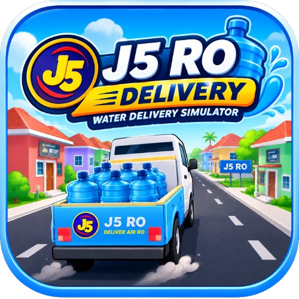

# J5 RO — Jefive RO

<div align="center">



**Game 3D antar galon air RO di Desa Tuapejat, Kab. Kepulauan Mentawai**

Satu shift. Tiga menit. Antar galon RO, kelola kas dan armada, rawat kendaraan, dan jadilah supir terbaik.

</div>

> Dokumentasi ini mengikuti implementasi terbaru `www/index.html` pada proyek `jefive-delivery-android`, termasuk menu utama bergaya arcade, pengaturan volume, panduan singkat, jeda/resume shift, kombo, PERFECT, medali, dan efek juice.

---

## Daftar Isi

- [Tentang Game](#tentang-game)
- [Fitur Utama](#fitur-utama)
- [Persyaratan](#persyaratan)
- [Struktur Proyek](#struktur-proyek)
- [Instalasi dan Menjalankan](#instalasi-dan-menjalankan)
- [Alur Permainan](#alur-permainan)
- [Kontrol](#kontrol)
- [Aturan Permainan](#aturan-permainan)
- [Kombo, PERFECT, Skor, dan Medali](#kombo-perfect-skor-dan-medali)
- [Ekonomi](#ekonomi)
- [Armada dan Toko Mobil](#armada-dan-toko-mobil)
- [Bengkel dan Perawatan](#bengkel-dan-perawatan)
- [Catatan Harian](#catatan-harian)
- [HUD dan Peta Mini](#hud-dan-peta-mini)
- [Dunia dan Tampilan](#dunia-dan-tampilan)
- [Siklus Siang-Malam dan Cuaca](#siklus-siang-malam-dan-cuaca)
- [Efek Juice, Haptik, dan Getaran](#efek-juice-haptik-dan-getaran)
- [Audio](#audio)
- [Penyimpanan dan Cadangan Data](#penyimpanan-dan-cadangan-data)
- [Dokumentasi Teknis](#dokumentasi-teknis)
- [Konfigurasi](#konfigurasi)
- [Mengganti Logo](#mengganti-logo)
- [Deployment](#deployment)
- [Troubleshooting](#troubleshooting)
- [Batasan dan Catatan](#batasan-dan-catatan)
- [Kredit](#kredit)

---

## Tentang Game

**J5 RO — Jefive RO** adalah game 3D *driving/delivery arcade* yang berjalan di browser dan juga dibungkus sebagai aplikasi Android menggunakan Capacitor. Seluruh HTML, CSS, dan logika permainan berada di dalam satu `index.html`; Three.js r160 disertakan secara lokal sehingga game tidak membutuhkan CDN, backend, database, atau koneksi internet.

Pemain mengendarai pick-up air RO untuk mengantar pesanan galon kepada warga **Desa Tuapejat, Kab. Kepulauan Mentawai**. Kota terdiri dari grid **3 × 3 blok** dengan **35 rumah** dan **delapan jalan bernama**. Setiap rumah memiliki nomor, sisi ganjil/genap, warna, dan titik pengantaran.

Dalam satu shift, pemain harus:

- memilih pesanan yang masuk,
- menemukan rumah yang benar,
- berhenti di area pengantaran,
- mengantar galon sebelum countdown pesanan habis,
- menjaga kombo pengantaran agar skor dan pendapatan meningkat,
- mengisi ulang stok di Depot J5 RO,
- mengelola saldo untuk membeli armada dan merawat kendaraan.

Permainan dirancang untuk sesi singkat **180 detik (3 menit)** dan mendukung keyboard, layar sentuh, serta orientasi landscape.

### Identitas Game

| Item | Keterangan |
|---|---|
| Nama game | J5 RO — Jefive RO |
| Genre | Driving / delivery arcade |
| Latar | Desa Tuapejat, Kab. Kepulauan Mentawai |
| Durasi satu shift | 180 detik (3 menit) |
| Mode | Single-player, sesi singkat |
| Platform | Browser modern dengan WebGL; Android melalui Capacitor |
| Bahasa antarmuka | Indonesia |
| Penyimpanan | `localStorage` untuk profil, snapshot shift, armada, statistik, rekor, dan catatan harian |
| Audio | Web Audio API prosedural, tanpa file audio eksternal |
| Backend | Tidak ada |

---

## Fitur Utama

### Gameplay dan jeda

- Shift 3 menit dengan dua pesanan awal dan maksimal lima pesanan aktif.
- Pesanan acak: pelanggan, nama jalan, nomor rumah, warna rumah, sisi ganjil/genap, jumlah galon (1–3), dan countdown 58–80 detik.
- Pengantaran manual dengan `E` atau otomatis setelah kendaraan berhenti di titik pengantaran.
- Penanda pesanan kuning di dunia 3D, daftar pesanan, objective bar, dan garis navigasi pada peta mini.
- Stok galon di bak, isi ulang gratis di **Depot J5 RO**, dan kapasitas yang mengikuti mobil aktif.
- **Jeda manual** lewat tombol **⏸ Jeda** di HUD, tombol `P`, atau `Esc` saat tidak ada modal terbuka.
- **Jeda otomatis** saat tab disembunyikan, jendela kehilangan fokus, atau gerbang portrait aktif di perangkat sentuh. Shift tetap beku sampai pemain menekan **Lanjutkan**.
- **Resume countdown 3 detik** setelah konfirmasi lanjut, sehingga permainan tidak langsung berjalan saat overlay ditutup.
- **Simpan & Keluar ke Menu** menyimpan snapshot shift yang bisa dilanjutkan lewat **Lanjutkan Shift**.
- **Akhiri Shift** meminta konfirmasi, menghitung hasil, memberi medali, lalu menghapus snapshot.
- Dealer dan bengkel tetap membiarkan waktu berjalan; jeda manual diabaikan selama modalnya terbuka.

### Menu utama, volume, dan panduan

- Menu utama bergaya arcade dengan logo berkilau, badge shift, ringkasan misi, tombol CTA besar, dan kartu quick-action **Garasi**, **Catatan**, **Cara Main**, serta **Pengaturan**.
- Panduan singkat tiga langkah tampil langsung di menu: pilih pesanan, berhenti dan antar, lalu isi stok atau servis.
- Tombol **Cara Main** membuka modal panduan yang lebih lengkap, termasuk kontrol keyboard/sentuh, alur pengantaran, kombo, PERFECT, dan tips jeda.
- Pengaturan volume **Master**, **Musik**, dan **Efek** tersedia di menu, modal Pengaturan, dan slider Master di overlay jeda. Ketiganya tersinkron dan tersimpan otomatis.
- Menu, modal, dan overlay tetap dapat digunakan pada desktop, layar sentuh, dan landscape pendek. Pada landscape sangat pendek, kartu bawah disembunyikan agar tombol utama tetap terlihat; volume tetap dapat diatur dari Pengaturan atau layar jeda.
- **Tampilan mobile sudah dioptimalkan**: target sentuh dilebarkan (tombol utama 54 px, tombol sub 42 px, tombol suara 44 px), slider memakai thumb besar 19 px dengan `touch-action: none` agar halaman tidak ikut bergulir saat menggeser, dan padding mengikuti *safe area* notch/layar tepi.
- Di ponsel portrait, ringkasan 3 langkah berubah menjadi tiga kartu sejajar agar menu tidak terlalu tinggi; di ponsel kecil (≤ 430 px) pita dekoratif disembunyikan. Menu juga otomatis kembali ke posisi paling atas setiap kali dibuka.
- `@media (pointer: coarse)` menangani perangkat sentuh, `@media (orientation: portrait)` menangani ponsel, dan `@media (prefers-reduced-motion: reduce)` mematikan animasi menu untuk pengguna yang butuh gerakan minimal.

### Kombo, PERFECT, dan medali

- Kombo pengantaran beruntun dengan jendela **40 detik**.
- Tier kombo: **2/4/6/9** pengantaran menghasilkan multiplier skor **1,10/1,25/1,50/2,00**.
- Uang memakai multiplier terpisah `1 + (multiplier skor − 1) × 0,5`, tanpa mengubah harga galon atau bonus kecepatan dasar.
- Kombo putus jika pesanan terlewat, terjadi tabrakan yang menimbulkan kerusakan, atau jendela 40 detik habis.
- **PERFECT** jika sisa waktu pesanan saat antar minimal **55%** dari umur awal pesanan dan tidak ada tabrakan selama pesanan itu aktif. PERFECT memberi bonus skor **+50** dan label khusus.
- HUD kombo hanya muncul saat kombo **≥ 2**, menampilkan jumlah, multiplier, dan bar jendela kombo.
- Medali shift dengan ambang tetap: **Perunggu 600**, **Perak 1.200**, **Emas 2.000** poin.
- HUD menampilkan target medali berikutnya; pencapaian ambang memunculkan toast dan jingle.
- Layar hasil menampilkan medali animasi, combo maksimal, jumlah PERFECT, dan total medali profil di dekat rekor menu.
- Medali Emas memicu confetti saat `CONFIG.fx.enabled` aktif; animasi tetap menghormati `prefers-reduced-motion`.

### Ekonomi dan progresi

- Modal awal **Rp 100.000**.
- Pendapatan per galon, bonus sisa waktu, bonus hujan, dan bonus uang kombo.
- Tiga armada yang dapat dibeli dan dipakai: J5 Mini (gratis), J5 Sedang (Rp 350.000), dan J5 Jumbo (Rp 900.000) — reachable lewat menabung ±2–3 shift dan ±5–8 shift.
- Kondisi mesin/bodi, oli, dan ban per mobil yang aus seiring jarak tempuh dan benturan; oli perlu diganti ±5 shift, ban ±7 shift, dan mesin ±10–15 shift.
- Bengkel untuk perbaikan, ganti oli, isi angin, servis total, dan derek darurat.
- Catatan harian berisi pesanan, pengantaran, kegagalan, galon, pemasukan, pengeluaran, armada yang dipakai, dan riwayat transaksi.
- Ekspor/impor cadangan JSON dan reset progres.
- Statistik profil permanen: jumlah medali, kombo terbaik, dan total pengantaran PERFECT.

### Dunia dan presentasi

- Kota pesisir low-poly dengan 35 rumah, delapan jalan bernama, dermaga, kantor bupati, depot, bengkel, dan dealer.
- **Dua warung** di sudut blok, lampu taman di sudut blok, dan pot bunga di sudut lainnya.
- Detail rumah: pagar rendah, pot tanaman, lampu teras, bunga, jemuran, parabola, kotak surat, papan nomor, dan skuter parkir pada beberapa rumah.
- Skuter parkir di area warung, suasana pantai, pohon kelapa, langit bergradasi, cakram matahari, cahaya hangat, dan fog.
- Siklus siang-malam **07:00–20:00** yang mengikuti sisa waktu shift, lengkap dengan busur matahari, bulan, bintang, langit berkeyframe, dan lampu yang menyala otomatis.
- Empat puluh delapan lampu jalan di sepanjang delapan jalan, jendela rumah bervariasi, serta lampu depan seluruh armada.
- Cuaca dinamis **cerah, berawan, dan hujan** dengan transisi halus, jalan basah, partikel hujan, kabut, dan audio hujan prosedural.
- Peta mini yang menampilkan jalan, rumah, laut/dermaga, depot, bengkel, dealer, posisi truk, target terpilih, dan garis navigasi.
- Efek juice: partikel pengantaran, percikan koin, cincin tanah, pop galon, centang kartu pesanan, FOV kick, uang melayang, getaran layar, kilatan kerusakan, dan peringatan timer 10 detik.

### NPC warga (suasana hidup)

- **13 NPC**(low-poly) berjalan di trotoar kota:pria & wanita dengan bentuk, warna pakaian, kulit, dan rambut acak.
- Perilaku: menyusuri trotoar blok, **sekali-sekali menyeberang zebra cross** di persimpangan, dan **terkadang masuk rumah** — warga masuk **lewat pintu rumah** (berjalan ke titik pintu, menghilang di dalam 5–13 detik), lalu **muncul kembali di pintu rumah lain** dan berjalan keluar ke trotoar.
- **4 NPC tambahan** di daerah Pelabuhan Tuapejat: dua di jalur pasir dekat dermaga dan dua di atas dek dermaga.
- Semua NPC memakai **5 `InstancedMesh`** (badan, kepala, rambut, rok, kaki) → seluruh warga hanya **±5 draw call**, tidak menambah beban berarti di HP.
- Kaki berayun, badan sedikit naik-turun, dan arah badan halus berputar mengikuti arah jalan.
- **Warna NPC dihitung sekali** (slot instance tetap, tidak diunggah ulang tiap frame) → per frame cukup upload matriks.
- **Warga punya collider bergerak** (0,76 × 0,76) → **truk tidak boleh menembus orang**. Truk yang menabrak warga langsung tertahan di posisi terakhir (tidak menembus) dan tidak terdorong oleh gerak warga; notifikasi "Hati-hati! Ada warga di jalan." muncul maksimal sekali tiap 1,6 detik agar tidak berdering terus. Warga yang masuk rumah otomatis menonaktifkan collider-nya.

### Kendaraan NPC (rintangan di jalan)

- **4 kendaraan warga** melintas mengelilingi kota dengan berbagai bentuk: **mobil kota** (sedan), **angkot/minibus**, **pikuk** (bak kargo), dan **truk box**.
- **Ukuran mendekati kendaraan pemain** (J5 Mini ≈ 2,3 × 4,4 unit): mobil 2,1 × 4,0; angkot 2,2 × 4,3; pikuk 2,1 × 4,2; truk box 2,3 × 4,6. Detailnya dibuat rapi: bodi, kap, kaca depan/samping/belakang, spion, bumper, gril, lampu depan menyala, lampu rem merah, roda ber-hub, dan muatan peti pada bak pikuk.
- **Warna natural khas desa** (krem, teal, biru laut, merah bata, hijau daun, oker, perak) memakai palet terpisah per jenis kendaraan, bukan warna acak norak.
- Semuanya bergerak mengikuti lajur jalan (3 unit dari aspal tengah) dan berputar halus di persimpangan, memakai 2 jalur luar dan 2 jalur dalam kota.
- **Jadi rintangan sungguhan**: tiap kendaraan punya collider yang bergerak, sehingga truk tertahan dan tidak bisa menembusnya → pemain harus lebih ekstra hati-hati di jalan.
- **Hak jalan (berhenti & kembali ke jalur)**: begitu terdapat truk di depan (mendekati 7,5 unit) atau amat dekat di samping/belakang (4,6 unit), kendaraan warga **berhenti** dan menunggu. Begitu truk menjauh, kendaraan melanjutkan rute di jalurnya sendiri.
- **Tidak saling terdorong**: tabrakan dengan kendaraan warga **tidak memindahkan truk** (truk ditahan di posisi terakhir), sehingga pemain tetap bisa mundur dan melawan — tidak ada truk yang terdorong terus ke belakang.
- Menabrak kendaraan warga dianggap **benturan ringan**: truk berhenti, tidak merusak mesin/ban, **tidak kena denda**, dan hanya muncul toast "Hati-hati! Menabrak kendaraan warga."
- Bentuk kendaraan digabung menjadi **2 mesh** (badan ber-vertex-color + lampu emissive) → hanya **±2 draw call per kendaraan**.

### Audio

- Suara mesin prosedural yang berubah mengikuti kecepatan, gas, dan permukaan jalan.
- Musik latar prosedural 84 BPM dengan progresi akor, arpeggio, kick, shaker, dan delay.
- Efek suara klakson, pengantaran berhasil, pesanan baru, peringatan, isi ulang, dan pesanan kedaluwarsa.
- **Klakson memakai file asli `car_horn.mp3`** (58 KB, diputar dari awal setiap kali tombol H / tombol klakson ditekan). Volumenya mengikuti slider **Master × Efek** (dikalikan `0.55` supaya tidak melebihi suara mesin); kalau file gagal dimuat, game otomatis memakai klakson prosedural dua nada.
- Efek baru: koin pentatonik yang naik mengikuti kombo, arpeggio PERFECT, suara kombo putus, jingle medali, dan peringatan sisa 10 detik.
- Audio hujan prosedural yang volumenya mengikuti intensitas hujan, menghormati master mute, dan berhenti saat shift selesai.
- Master mute, pengaturan musik terpisah, volume Master/Musik/Efek yang dapat diatur, penangguhan audio saat jeda/tab tidak terlihat, serta preferensi haptik dan getaran layar.

### Mobile dan teknis

- Kontrol sentuh berupa joystick melayang atau D-Pad; gaya kontrol dapat diganti dan diingat.
- Tombol aksi kontekstual: `ANTAR`, `STOK`, `ISI`, `SERVIS`, atau `DEALER`.
- Gerbang orientasi landscape, tombol layar penuh, dan panel pesanan yang dapat dilipat di perangkat sentuh.
- Jeda otomatis saat gerbang portrait aktif; lanjut hanya setelah pemain berkonfirmasi.
- Three.js r160 lokal, tanpa aset audio eksternal, tanpa build step untuk versi web.
- Optimasi static mesh batching, resource sharing, pembatasan pixel ratio, dan mode hemat daya otomatis.
- Partikel 3D memakai pool; tidak ada geometri atau material baru per efek pengantaran.

---

## Persyaratan

### Untuk pemain web

- Browser modern: **Chrome, Edge, Firefox, atau Safari** versi terbaru.
- WebGL aktif dan JavaScript diizinkan.
- File `index.html` dan `three.min.js` berada di folder yang sama.
- `localStorage` tersedia jika ingin menyimpan profil dan snapshot shift. Mode privat atau pembatasan browser dapat menonaktifkannya.
- Audio browser aktif; suara baru dimulai setelah pemain berinteraksi dengan halaman.
- Haptik membutuhkan dukungan `navigator.vibrate` pada perangkat/browser.
- Tidak membutuhkan koneksi internet saat bermain.

### Untuk pengembangan

Tidak ada dependensi yang perlu di-install untuk menjalankan versi web. Cukup buka `index.html` atau jalankan server statis dari folder `www`.

Opsional:

- **Python 3**, atau
- **Node.js + npx**, atau
- Ekstensi **Live Server** di Visual Studio Code.

### Untuk build Android

- Node.js dan npm.
- JDK yang kompatibel dengan Android Gradle Plugin proyek (disarankan JDK 17 atau lebih baru).
- Android SDK dengan platform yang sesuai.
- Proyek Capacitor di folder induk `www`.

---

## Struktur Proyek

```text
jefive-delivery-android/
├── www/
│   ├── index.html                 # Game lengkap: HTML + CSS + JavaScript
│   ├── three.min.js               # Three.js r160 lokal (wajib)
│   ├── The_Midnight_Run.mp3       # Musik latar game (loop, opsional)
│   ├── car_horn.mp3               # Suara klakson (opsional, ada cadangan prosedural)
│   ├── JEFIVE_COMPANY_LOGO.png    # Logo sumber; sudah disematkan di index.html
│   └── README.md                  # Dokumentasi ini
├── android/                       # Proyek Android hasil Capacitor
├── assets/                        # Aset ikon/logo untuk build Android
├── capacitor.config.json          # appId, appName, dan webDir "www"
├── package.json                   # Dependensi Capacitor
├── package-lock.json
└── CARA BUILD.txt                 # Catatan singkat build Android
```

### File yang dibutuhkan saat bermain

Minimal dua file harus berada dalam folder yang sama:

- **`www/index.html`** — seluruh struktur, tampilan, dan logika game.
- **`www/three.min.js`** — library Three.js r160 yang dimuat secara lokal.

Tambahan opsional:

- **`www/The_Midnight_Run.mp3`** — musik latar game yang diputar loop. Bila file ini tidak ada atau gagal dimuat, game otomatis memakai musik prosedural bawaan.
- **`www/car_horn.mp3`** — suara klakson asli. Bila file ini tidak ada atau gagal dimuat, game otomatis memakai klakson prosedural bawaan (dua nada bergantian).

Logo sudah disematkan sebagai data URI di dalam `index.html`. File `JEFIVE_COMPANY_LOGO.png` adalah sumber logo dan tidak wajib didistribusikan kecuali `LOGO_SRC` diubah menjadi file eksternal.

Tidak ada permintaan ke CDN atau server eksternal saat game berjalan, sehingga game dapat dimainkan secara offline.

---

## Instalasi dan Menjalankan

### Opsi 1 — Membuka langsung

1. Unduh atau salin folder proyek.
2. Pastikan `index.html` dan `three.min.js` berada di folder yang sama.
3. Buka `index.html` di browser.

Cara ini paling cepat. Namun, beberapa browser membatasi `localStorage`, fullscreen, atau orientasi saat halaman dibuka melalui `file://`. Server lokal disarankan agar penyimpanan dan API browser berjalan lebih konsisten.

### Opsi 2 — Server lokal

Jalankan dari folder `www`:

#### Python

```bash
cd "jefive-delivery-android/www"
python -m http.server 8123
```

Buka:

```text
http://localhost:8123
```

#### Node.js

```bash
cd "jefive-delivery-android/www"
npx serve -l 8123 .
```

Buka:

```text
http://localhost:8123
```

#### VS Code Live Server

1. Buka folder proyek di VS Code.
2. Klik kanan `www/index.html`.
3. Pilih **Open with Live Server**.
4. Browser akan membuka alamat lokal yang disediakan ekstensi.

### Opsi 3 — Build aplikasi Android

Jalankan dari folder induk `jefive-delivery-android`:

```bash
npm install
npx cap sync android
cd android
.\gradlew.bat assembleDebug
```

Di macOS/Linux, gunakan:

```bash
./gradlew assembleDebug
```

APK debug dihasilkan di:

```text
android/app/build/outputs/apk/debug/app-debug.apk
```

Catatan Android:

- `capacitor.config.json` menggunakan `appId` **`com.jefive.delivery`**, `appName` **`JEFIVE Delivery`**, dan `webDir` **`www`**.
- `AndroidManifest.xml` mengunci aktivitas ke **`sensorLandscape`**, sehingga aplikasi Android tampil dalam orientasi landscape.
- Setiap kali `www` diubah, jalankan kembali `npx cap sync android` sebelum build ulang.
- Untuk APK release, gunakan Android Studio atau konfigurasi signing Gradle.

### Cara memulai permainan

1. Buka game dan tunggu loader **“Menyiapkan Desa Tuapejat, Kab. Kepulauan Mentawai”** selesai.
2. Di menu utama, pilih salah satu:
   - **Lanjutkan Shift** — hanya muncul jika ada snapshot shift valid. Memulihkan posisi, sisa waktu, pesanan, stok, skor, kombo, cuaca, dan keuangan sesi, lalu membuka overlay jeda.
   - **Permainan Baru** — memulai shift baru. Jika ada snapshot atau progres profil, game meminta konfirmasi. Snapshot dihapus; jika profil punya progres, profil direset ke awal.
   - **Garasi**, **Catatan**, **Cara Main**, atau **Pengaturan** lewat tombol quick-action.
   - Slider volume **Master**, **Musik**, dan **Efek** di kartu audio menu bila ingin mengatur suara sebelum bermain.
3. Gunakan daftar pesanan di kanan, tombol angka `1`–`5`, atau ketuk kartu pesanan untuk memilih tujuan.
4. Ikuti penanda kuning dan peta mini menuju rumah pesanan.
5. Berhenti di titik pengantaran, lalu tekan `E` atau tunggu proses otomatis.
6. Isi ulang galon di **Depot J5 RO** jika stok menipis.
7. Manfaatkan **Bengkel Mentawai** dan **Dealer J5 Tuapejat** sebelum waktu habis. Waktu tetap berjalan selama modal ini terbuka.
8. Tekan **⏸ Jeda** untuk menghentikan shift, lalu pilih **Lanjutkan**, **Simpan & Keluar ke Menu**, atau **Akhiri Shift**.
9. Setelah timer `00:00` atau konfirmasi **Akhiri Shift**, lihat laporan shift dan pilih **Mulai Shift Baru**, **Catatan Harian**, atau **Menu Utama**.

> Tombol pause berada di HUD kanan atas dengan label **⏸ Jeda**. Jeda tidak sama dengan mengakhiri shift: **Simpan & Keluar ke Menu** mempertahankan snapshot untuk dilanjutkan, sedangkan **Akhiri Shift** menutup shift dan menghitung hasil.

---

## Alur Permainan

```text
Menu utama
   │
   ├── Lanjutkan Shift ─────► snapshot dipulihkan ─► overlay jeda ─► Lanjutkan
   ├── Permainan Baru ──────► konfirmasi (jika ada progres/snapshot) ─► shift baru
   ├── Garasi ─────────────► beli / pilih armada
   ├── Catatan ────────────► rekap dan riwayat transaksi
   ├── Cara Main ──────────► panduan singkat + kontrol
   └── Pengaturan ─────────► ekspor / impor / reset / volume / musik / haptik / getaran
                                       │
                                       ▼
                               Shift 3 menit
                                       │
        ┌──────────────────────────────┼──────────────────────────────┐
        ▼                              ▼                              ▼
  Antar pesanan                  Isi ulang depot             Servis / dealer
        │                              │                              │
        └──────────────────────────────┴──────────────────────────────┘
                                       │
                     ┌─────────────────┴─────────────────┐
                     ▼                                   ▼
             ⏸ Jeda / P / Esc                   Timer 00:00
                     │                                   │
          ┌──────────┼──────────┐                        ▼
          ▼          ▼          ▼                 Laporan shift
     Lanjutkan   Simpan &    Akhiri Shift               │
     (3 detik)   Keluar      (konfirmasi)        ┌───────┴────────┐
          │          │          │                ▼                ▼
          ▼          ▼          ▼          Mulai Shift Baru   Menu Utama
       playing     menu      laporan
                  (snapshot)  shift
```

### Siklus satu shift

1. Shift dimulai dengan **stok penuh sesuai kapasitas mobil aktif** dan **dua pesanan awal**.
2. Pesanan baru masuk selama waktu shift masih lebih dari 14 detik dan jumlah pesanan belum mencapai lima.
3. Pemain memilih pesanan, mengemudi, dan berhenti di rumah yang tepat.
4. Pengantaran mengurangi stok, menambah saldo, menambah skor, dan memperbarui kombo.
5. Jika stok tidak cukup, pemain harus mengisi ulang di depot. Pengisian ulang gratis.
6. Kondisi mobil menurun karena jarak tempuh dan benturan. Servis tersedia di bengkel.
7. Saat waktu habis, game menampilkan skor, pesanan terantar, galon terjual, pesanan terlewat, combo maksimal, PERFECT, medali, pendapatan, pengeluaran, laba bersih, dan saldo akhir.
8. Rekor baru dicatat dan medali diberikan jika skor memenuhi ambang.
9. Memilih **Mulai Shift Baru** dari hasil mempertahankan profil dan armada, lalu memulai shift baru.

### Jeda, simpan, dan lanjutkan

- **Jeda manual** membekukan waktu shift, countdown pesanan, gerak kendaraan, input, keausan, cuaca, kombo, auto-delivery, auto-refill, dan efek gameplay.
- **Jeda otomatis** terjadi saat tab disembunyikan, jendela kehilangan fokus, atau gerbang portrait aktif pada perangkat sentuh. Alasan jeda ditampilkan di overlay; pemain harus menekan **Lanjutkan**.
- Saat overlay jeda terbuka, pemain dapat mengubah musik, haptik, dan getaran layar lewat tombol cepat, serta mengatur **Volume Master** lewat slider.
- **Lanjutkan** memulai hitungan **3 detik**. Hitungan dibatalkan jika terjadi jeda otomatis lagi, **Simpan & Keluar**, atau **Akhiri Shift**.
- **Simpan & Keluar ke Menu** menyimpan profil dan snapshot, menutup overlay, lalu kembali ke menu. Shift **tidak** dianggap selesai, jadi rekor dan medali belum diperbarui.
- **Akhiri Shift** menampilkan konfirmasi. Jika disetujui, shift langsung berakhir, hasil dihitung, medali diberikan, dan snapshot dihapus.
- Jeda manual **diabaikan** saat modal dealer, bengkel, kalender, pengaturan, atau konfirmasi sedang terbuka. Modal dealer dan bengkel tetap membiarkan waktu berjalan.
- Jeda otomatis dari tab tersembunyi dapat terjadi walaupun modal sedang terbuka; state game tetap dibekukan sampai konfirmasi.

---

## Kontrol

### Keyboard

| Tombol | Fungsi |
|---|---|
| `W` atau `↑` | Gas / maju |
| `S` atau `↓` | Mundur; saat masih melaju, memperlambat kendaraan |
| `A` atau `←` | Belok kiri |
| `D` atau `→` | Belok kanan |
| `Spasi` | Rem |
| `E` | Antar galon, isi ulang di depot, atau buka bengkel/dealer |
| `1`–`5` | Pilih pesanan sesuai urutan kartu |
| `H` | Klakson |
| `M` | Nyalakan atau matikan seluruh suara |
| `P` | Jeda shift saat bermain; lanjutkan saat overlay jeda terbuka |
| `Esc` | Saat modal terbuka: tutup modal. Saat tidak ada modal: jeda/lanjutkan shift |
| Klik kartu pesanan | Memilih pesanan |
| Tombol **⏸ Jeda** di HUD | Membuka overlay jeda |

Catatan:

- `P` dan `Esc` hanya berfungsi sebagai pause/resume jika **tidak ada modal** yang terbuka.
- Jika ada modal, `Esc` menutup modal dan `P` diabaikan.
- Saat overlay jeda terbuka, `P` atau `Esc` memulai resume countdown 3 detik.
- Saat countdown berjalan, tekan `P`/`Esc` lagi tidak mempercepat atau membatalkan countdown; tunggu hingga selesai, atau gunakan tombol **Simpan & Keluar** / **Akhiri Shift**.
- Menutup atau meninggalkan halaman saat bermain ikut menyimpan snapshot lewat event `pagehide`.

### Menu utama

| Kontrol | Fungsi |
|---|---|
| **Lanjutkan Shift** | Memulihkan snapshot shift valid, bila ada |
| **Permainan Baru** | Memulai shift baru; konfirmasi bila ada progres atau snapshot |
| **Garasi** | Membuka dealer dan pilihan armada |
| **Catatan** | Membuka rekap harian dan riwayat transaksi |
| **Cara Main** | Membuka modal panduan singkat dan kontrol |
| **Pengaturan** | Membuka volume, ekspor/impor, reset, musik, haptik, dan getaran |
| Slider **Master / Musik / Efek** | Mengatur volume langsung dari menu; nilai tersimpan otomatis |
| Tombol speaker | Master mute; volume yang dipilih tetap tersimpan |

### Kontrol sentuh

| Kontrol | Fungsi |
|---|---|
| Joystick kiri | Setir analog; dorong ke atas untuk gas dan ke bawah untuk mundur |
| D-Pad | Alternatif joystick: ▲ maju, ▼ mundur, ◀ kiri, ▶ kanan |
| **REM** | Rem |
| Tombol aksi utama | Kontekstual: **ANTAR**, **STOK**, **ISI**, **SERVIS**, atau **DEALER** |
| **H** | Klakson |
| Ketuk kartu pesanan | Memilih pesanan |
| Ketuk header daftar pesanan | Melipat/membuka panel pesanan |
| Tombol ganti kontrol | Beralih antara joystick dan D-Pad |
| Tombol layar penuh | Masuk/keluar fullscreen dan mencoba mengunci landscape |
| Tombol suara | Master mute |
| Tombol **⏸ Jeda** | Membuka overlay jeda |
| Tombol overlay jeda | **Lanjutkan**, **Simpan & Keluar ke Menu**, atau **Akhiri Shift** |
| Tombol cepat jeda | Musik, haptik, dan getaran layar |
| Slider **Volume Master** di overlay jeda | Mengatur volume seluruh audio saat shift dijeda |

Kontrol sentuh muncul otomatis pada perangkat dengan pointer kasar, perangkat tanpa hover, atau perangkat sentuh dengan lebar layar terbatas. Untuk pengujian, tambahkan `?touch=1` pada URL untuk memaksa mode sentuh, atau `?touch=0` untuk memaksa mode desktop.

Pada perangkat sentuh, game menampilkan gerbang orientasi portrait yang meminta perangkat diputar ke landscape. Jika gerbang masih aktif, game otomatis masuk jeda ketika orientasi portrait terdeteksi. Di Android, orientasi sudah dikunci melalui manifest.

---

## Aturan Permainan

### Shift dan waktu

- Satu shift berlangsung **180 detik**.
- Jam simulasi berjalan dari **07:00** ke **20:00** mengikuti progres shift, bukan jam perangkat.
- Cuaca diundi saat shift dimulai dan dapat berubah sekali di tengah shift.
- Timer HUD memakai keadaan waspada saat sisa waktu **30 detik atau kurang**.
- Saat sisa waktu **10 detik atau kurang**, game menampilkan peringatan, suara, dan getaran (jika efek dan haptik aktif), serta timer masuk keadaan kritis.
- Shift berakhir saat timer mencapai **00:00** atau saat **Akhiri Shift** dikonfirmasi.
- Jeda manual dan jeda otomatis membekukan waktu serta seluruh simulasi gameplay.
- Membuka modal bengkel atau dealer saat shift berjalan **tidak menghentikan timer maupun countdown pesanan**.
- Pesanan baru berhenti muncul saat sisa waktu shift **14 detik atau kurang**.
- **Simpan & Keluar ke Menu** tidak mengakhiri shift; shift tetap tersimpan sampai dilanjutkan atau diakhiri.

### Pesanan

- Shift dimulai dengan **dua pesanan**.
- Maksimal **lima pesanan aktif** dalam satu waktu.
- Pesanan baru muncul setiap **7–13 detik** selama masih ada slot dan waktu shift mencukupi.
- Setiap pesanan memiliki:
  - nama pelanggan,
  - nama jalan dan nomor rumah,
  - label warna rumah,
  - sisi ganjil/genap,
  - jumlah galon **1–3**,
  - countdown awal **58–80 detik**.
- Rumah pesanan menampilkan tumpukan galon biru dan penanda kuning **PESANAN** dengan beam cahaya.
- Kartu pesanan menampilkan countdown; kartu berubah merah saat sisa waktu **15 detik atau kurang**.
- Satu rumah hanya menampung satu pesanan aktif pada satu waktu.

### Memilih pesanan

- Klik/ketuk kartu pesanan atau tekan `1`–`5`.
- Pesanan pertama otomatis dipilih jika belum ada pilihan.
- Pesanan terpilih ditampilkan pada **objective bar** di HUD.
- Peta mini menampilkan semua rumah pesanan; target terpilih diberi cincin dan garis putus-putus dari posisi truk.
- Memilih pesanan tidak mengunci pengantaran. Saat kendaraan berada dalam radius beberapa rumah pesanan, game memproses pesanan terdekat yang memenuhi syarat.

### Mengantar galon

Pengantaran berhasil jika:

- rumah yang didekati adalah rumah dengan pesanan aktif,
- kendaraan berada dalam radius pengantaran **6,3 unit** dari titik antar,
- kendaraan cukup pelan/berhenti,
- stok galon di bak mencukupi jumlah yang diminta.

Cara mengantar:

1. Berhenti di depan rumah pesanan.
2. Tekan `E` atau tombol **ANTAR**.
3. Alternatif: tetap berhenti. Setelah **2,8 detik**, pengantaran otomatis berjalan.

Ketentuan tambahan:

- Aksi manual `E` membutuhkan kecepatan di bawah **1,6**.
- Pengantaran otomatis hanya berjalan jika kecepatan di bawah **0,68** dan stok mencukupi.
- Pengantaran tidak bisa sebagian. Jika pesanan meminta 3 galon dan stok hanya 2, pemain harus mengisi ulang terlebih dahulu.
- Pengantaran mengurangi stok sebesar jumlah galon pesanan.
- Rumah yang tidak sedang memesan tidak bisa diantar; game akan menampilkan peringatan.
- Setelah pengantaran, rumah terkait memainkan animasi pop galon, kartu pesanan mendapat centang, dan efek juice dipicu jika aktif.

### Stok dan depot

- Kapasitas bak mengikuti mobil aktif:
  - J5 Mini: **10 galon**,
  - J5 Sedang: **20 galon**,
  - J5 Jumbo: **40 galon**.
- Shift selalu dimulai dengan stok penuh sesuai kapasitas mobil aktif.
- Setiap pengantaran mengurangi stok.
- Isi ulang dilakukan di **Depot J5 RO** di area selatan kota.
- Isi ulang **gratis** dan langsung mengisi bak sampai kapasitas maksimum.
- Berhenti di zona depot lalu:
  - tekan `E`, atau
  - tunggu **1,55 detik** untuk isi ulang otomatis.
- Jika bak masih penuh, game menampilkan pesan bahwa belum perlu mengisi ulang.
- Saat berganti ke mobil berkapasitas lebih kecil, stok yang ada dipotong agar tidak melebihi kapasitas baru.

### Pesanan terlewat

- Jika countdown pesanan mencapai nol, pesanan dianggap **terlewat**.
- Jumlah pesanan terlewat (`missed`) bertambah.
- Skor berkurang **25 poin**, dengan batas minimal skor 0.
- Kombo langsung putus jika sedang aktif.
- Tidak ada potongan saldo karena pesanan terlewat.
- Rumah kembali menjadi rumah biasa dan bisa menerima pesanan baru.

### Akhir shift

Saat timer habis atau **Akhiri Shift** dikonfirmasi:

- shift berakhir dan layar hasil ditampilkan,
- snapshot shift dihapus,
- skor akhir dibandingkan dengan rekor tersimpan,
- medali shift diberikan sesuai skor,
- jumlah pesanan terantar, galon terjual, pesanan terlewat, combo maksimal, dan PERFECT ditampilkan,
- pendapatan sesi, pengeluaran sesi, laba bersih, dan saldo akhir ditampilkan,
- tombol **Mulai Shift Baru**, **Catatan Harian**, dan **Menu Utama** tersedia.

Judul hasil mengikuti jumlah pesanan yang berhasil diantar:

| Pesanan terantar | Judul |
|---:|---|
| ≥ 10 | Supir Legendaris! |
| 6–9 | Shift Hebat! |
| 3–5 | Kerja Bagus! |
| 1–2 | Awal yang Baik! |
| 0 | Waktu Habis! |

Pesanan yang masih aktif saat waktu habis tidak diproses sebagai pesanan terlewat; shift langsung berakhir.

### Keluar lebih awal

- **Simpan & Keluar ke Menu** dari overlay jeda tidak menampilkan layar hasil dan tidak memperbarui rekor/medali saat itu.
- Snapshot shift disimpan sehingga **Lanjutkan Shift** dapat memulihkannya nanti.
- Pendapatan yang sudah masuk dari pengantaran sebelumnya tetap tersimpan di saldo dan catatan harian.
- **Akhiri Shift** adalah cara keluar yang menghitung hasil dan memberikan medali.
- Memilih **Permainan Baru** dari menu dapat menghapus snapshot dan mereset profil; konfirmasi selalu diminta jika ada progres atau snapshot.

---

## Kombo, PERFECT, Skor, dan Medali

### Kombo

Kombo dihitung dari jumlah pengantaran berhasil berturut-turut. Setiap pengantaran memberi jendela baru **40 detik**. Jika jendela habis, pesanan terlewat, atau terjadi tabrakan yang menimbulkan kerusakan, kombo kembali ke nol.

| Jumlah kombo | Multiplier skor | Multiplier uang |
|---:|---:|---:|
| 1 | 1,00 | 1,00 |
| 2–3 | 1,10 | 1,05 |
| 4–5 | 1,25 | 1,125 |
| 6–8 | 1,50 | 1,25 |
| 9+ | 2,00 | 1,50 |

- HUD kombo hanya tampil saat jumlah kombo **≥ 2**.
- Bar tipis menunjukkan sisa jendela 40 detik.
- Setiap kenaikan kombo memicu animasi pop jika `CONFIG.fx.enabled` aktif.
- Saat kombo aktif (≥ 2), kombo putus menampilkan pesan **“Combo putus!”** beserta alasan: pesanan terlewat, tabrakan, atau waktu kombo habis. Kombo yang baru berjumlah 1 akan direset tanpa pesan.
- Multiplier skor diterapkan penuh ke poin pengantaran. Multiplier uang memakai `1 + (multiplier skor − 1) × 0,5`, sehingga bonus uang lebih kecil daripada bonus skor.
- Harga galon, bonus kecepatan dasar, biaya, dan penalti tidak diubah oleh kombo.

### PERFECT

Sebuah pengantaran disebut **PERFECT** jika:

- sisa waktu pesanan saat antar minimal **55%** dari umur awal pesanan, dan
- tidak ada tabrakan selama pesanan tersebut aktif.

Efek PERFECT:

- bonus skor **+50**,
- label **PERFECT** pada toast dan uang melayang,
- percikan partikel tambahan, ring emas tambahan, dan FOV kick lebih kuat jika FX aktif,
- suara arpeggio khusus,
- jumlah PERFECT sesi dan total profil bertambah.

PERFECT tidak membutuhkan kombo. Pengantaran pertama pun bisa PERFECT selama memenuhi syarat.

### Skor

Base poin per pengantaran:

```text
base = 100 + (jumlah galon × 30) + round(sisa detik pesanan × 2)
```

Poin akhir:

```text
poin = round(base × multiplier kombo) + (PERFECT ? 50 : 0)
```

Keterangan:

- **100 poin** = bonus dasar per pesanan berhasil.
- **30 poin per galon** = jumlah galon yang diantar.
- **Bonus kecepatan** = sisa waktu pesanan × 2, dibulatkan terlebih dahulu.
- **Multiplier kombo** mengikuti tabel di atas dan diterapkan pada seluruh base poin.
- **Bonus PERFECT** ditambahkan setelah multiplier.
- Pesanan terlewat: **−25 poin**.
- Skor tidak turun di bawah 0.

Contoh:

```text
Pesanan 2 galon, sisa waktu 40 detik, kombo 4 (x1,25), PERFECT
base  = 100 + (2 × 30) + (40 × 2) = 240
poin  = round(240 × 1,25) + 50
      = 300 + 50
      = 350 poin
```

Skor berbeda dari saldo:

- skor menentukan rekor shift dan medali,
- saldo menentukan kemampuan membeli armada dan servis,
- keduanya diberikan dari pengantaran yang sama.

Rekor tertinggi dan medali hanya diperbarui saat shift berakhir normal, yaitu timer habis atau **Akhiri Shift** dikonfirmasi. **Simpan & Keluar ke Menu** belum mengakhiri shift. Rekor disimpan di `localStorage` dan ditampilkan di menu utama serta layar hasil.

### Medali

| Medali | Ambang skor |
|---|---:|
| 🥉 Perunggu | 600 |
| 🥈 Perak | 1.200 |
| 🥇 Emas | 2.000 |

- HUD skor menampilkan target medali berikutnya.
- Saat skor pertama kali melewati ambang dalam satu shift, muncul toast dan jingle medali; haptik ikut aktif jika `CONFIG.fx.enabled` dan preferensi haptik aktif.
- Layar hasil menampilkan medali yang diraih dengan animasi; jika belum ada medali, ditampilkan target berikutnya.
- Medali Emas memicu confetti emas saat `CONFIG.fx.enabled` dan `CONFIG.medals.enabled` aktif (dibatasi pada perangkat hemat daya dan dihilangkan saat reduced motion).
- Jumlah medali per jenis disimpan permanen dan totalnya ditampilkan di dekat rekor menu.
- Profil menyimpan:
  - `stats.medals.bronze`,
  - `stats.medals.silver`,
  - `stats.medals.gold`,
  - `stats.bestCombo`,
  - `stats.perfectCount`.
- Medali diberikan satu kali per shift yang berakhir normal. Snapshot restore tidak menggandakan medali.
- `CONFIG.medals.enabled = false` menyembunyikan target HUD, medali hasil, dan total menu, serta mencegah pemberian medali baru; statistik lama tetap tersimpan.

**Catatan kalibrasi:** ambang **600/1.200/2.000** adalah baseline tetap sesuai spesifikasi dan tidak dikalibrasi otomatis saat runtime. Jika hasil playtest manual menunjukkan perlu penyesuaian, ubah `CONFIG.medals.thresholds`, lalu uji ulang seluruh alur skor dan hasil.

---

## Ekonomi

### Modal dan pendapatan

- Modal awal pemain baru: **Rp 100.000**.
- Setiap pengantaran yang berhasil langsung menambah saldo dan total penjualan.
- Komponen pendapatan per pesanan:

```text
galon        = jumlah galon × Rp 10.000
kecepatan    = round(sisa detik pesanan × Rp 500)
dasar        = galon + kecepatan
bonus hujan  = round(dasar × 10%)        (hanya saat hujan aktif)
subtotal     = dasar + bonus hujan
pembayaran   = round(subtotal × multiplier uang kombo)
```

- Bonus hujan aktif jika `CONFIG.weather.enabled` dan intensitas hujan minimal **0,12**.
- Multiplier uang kombo mengikuti tabel kombo: **1,00 / 1,05 / 1,125 / 1,25 / 1,50**.
- Pembayaran yang dicatat ke saldo, total penjualan, pendapatan sesi, dan catatan harian adalah nominal akhir setelah bonus hujan dan kombo.
- Saldo tidak memiliki batas maksimum.
- Tidak ada biaya bahan bakar, gaji harian, atau sewa harian dalam sistem saat ini.
- Isi ulang galon di depot gratis.

### Grade shift & target harian

- **Target harian** ditampilkan di menu utama ("Target hari ini · Rp 120.000") lengkap dengan bar progres penjualan terakhir.
  - Target awal **Rp 120.000**, naik **Rp 1.000 per hari** sampai hari ke-60, dibatasi maksimal **Rp 400.000**.
  - Karena 1 sesi = 1 hari, progres direset otomatis setiap sesi baru.
- **Grade shift (S/A/B/C/D)** muncul di layar hasil, dihitung dari 3 komponen (total 10 poin):
  - **Skor** 0–4 poin (ambang 400 / 800 / 1.400 / 2.000)
  - **Combo terbaik** 0–3 poin (ambang 2 / 4 / 6)
  - **Efisiensi** 0–3 poin (pendapatan shift ÷ target harian ≥ 60% / 100% / 130%)
  - Grade: **S** ≥ 9 poin, **A** ≥ 7, **B** ≥ 5, **C** ≥ 3, selain itu **D**.
- Grade dan pendapatan shift terakhir disimpan di profil (`lastGrade`, `lastShiftIncome`) dan ditampilkan lagi di menu.

### Lampu lalu lintas & hak jalan

- **4 persimpangan utama** (pusat kota: ±19 / ±19) kini punya lampu lalu lintas: tiang, rumah lampu, dan bulb merah/kuning/hijau.
- Siklus lampu: **7 detik hijau** (salah satu arah) → **2 detik kuning** → **7 detik hijau** (arah sebaliknya), sinkron di semua persimpangan.
- **Melewati lampu merah = denda Rp 4.000** (dicatat di catatan harian sebagai "Denda Lampu Merah"), disertai toast dan bunyi error. Denda tidak bisa membuat saldo negatif.
- Tidak ada collider pada tiang lampu, jadi lampu tidak pernah menjadi sumber crash tak terduga.
- Biaya: 1 mesh tiang (gabungan) + 3 `InstancedMesh` bulb → hanya **4 draw call** untuk seluruh lampu lalu lintas.

---

### Denda tabrakan

- Setiap **tabrakan sungguhan** (kecepatan benturan di atas `fx.crashSpeedThreshold` = 3,2 m/s) memotong saldo:
  - `denda = clamp(2.000 + rasioKecepatan × 18.000, 3.000, 25.000) × pengaliBeruntun`
  - Rasio kecepatan = kecepatan benturan ÷ kecepatan maksimum armada.
- **Pengali beruntun**: menabrak lagi dalam **5 detik** akan mengalikan dendanya (×2, ×3, maksimal ×3). Di luar 5 detik, pengali kembali ke ×1.
- Denda dipotong langsung dari saldo (tidak membuat saldo negatif) dan **dicatat di catatan harian** sebagai pengeluaran "Denda Tabrakan".
- **Denda tabrakan** hanya berlaku untuk menabrak bangunan/objek tetap. Menabrak **kendaraan warga** atau **warga berjalan** hanya benturan ringan (truk tertahan & berhenti, tanpa kerusakan dan tanpa denda).
- Impact-nya: selain denda, tabrakan tetap merusak mesin/bodi & ban, memutus kombo, dan membatalkan status PERFECT untuk pesanan yang sedang diantar. Perbaikan di bengkel tetap berbayar seperti biasa.

Contoh:

```text
Pesanan 2 galon, sisa waktu 40 detik, hujan 10%, kombo 4 (multiplier uang 1,125)
galon       = 2 × 10.000 = 20.000
kecepatan   = 40 × 500 = 20.000
dasar       = 40.000
bonus hujan = 4.000
subtotal    = 44.000
pembayaran  = round(44.000 × 1,125)
            = 49.500
```

### Pengeluaran

Pengeluaran yang saat ini ada:

| Pengeluaran | Nilai |
|---|---:|
| Beli J5 Sedang | Rp 350.000 |
| Beli J5 Jumbo | Rp 900.000 |
| Perbaikan mesin/bodi | Rp 1.200 per 1% kerusakan, minimum Rp 6.000 |
| Ganti oli | Rp 18.000 |
| Isi angin ban | Rp 8.000 |
| Derek darurat | Rp 40.000 |

Pembelian dan servis hanya dapat dilakukan jika saldo mencukupi. Pengecualian: derek darurat tetap diberikan meskipun saldo kurang dari Rp 40.000; saldo akan dipotong sampai **Rp 0** dan mobil tetap diderek.

Keseimbangan ekonomi (perkiraan 1 shift = 3 menit):

| Tokoh | Kebutuhan | Keterangan |
|---|---|---|
| Ganti oli | ± 5 shift | Oli turun ± 21% per shift karena keausan jarak tempuh |
| Isi angin ban | ± 7 shift | Ban turun ± 13,5% per shift (kerusakan tabrakan ikut merusak ban) |
| Perbaikan mesin/bodi | ± 10–15 shift | Mesinaus ± 8% per shift, lebih cepat bila oli di bawah 25% |
| J5 Sedang | ± 2–3 shift penabung | Kapasitas 20 galon, lebih cepat dan lebih tahan benturan |
| J5 Jumbo | ± 5–8 shift penabung | Kapasitas 40 galon, paling kuat tapi paling mahal |

### Ringkasan keuangan

- **Saldo** adalah uang yang bisa dibelanjakan.
- **Pendapatan Sesi** adalah total pembayaran pengantaran pada shift berjalan.
- **Pengeluaran Sesi** adalah total belanja servis/armada pada shift berjalan.
- **Laba Bersih Sesi** = pendapatan sesi − pengeluaran sesi.
- **Total Jual** di HUD adalah total pendapatan kotor sepanjang profil, bukan laba bersih.
- Saldo, total penjualan, catatan harian, dan statistik disimpan di `localStorage`.

### Hubungan dengan snapshot

Snapshot menyimpan saldo dan keuangan sesi pada saat jeda. Saat **Lanjutkan Shift**, state keuangan dipulihkan dari snapshot, tetapi catatan harian dan pembayaran yang sudah tercatat **tidak diputar ulang**. Ini mencegah saldo atau transaksi berganda.

---

## Armada dan Toko Mobil

### Pilihan armada

| Armada | Harga | Kapasitas | Kecepatan maksimum | Akselerasi | Daya tahan | Catatan |
|---|---:|---:|---:|---:|---|---|
| **J5 Mini** | Gratis | 10 galon | 17 | 12,5 | Standar | Mobil awal, paling ringkas dan lincah |
| **J5 Sedang** | Rp 350.000 | 20 galon | 19 | 14,0 | 25% lebih tahan benturan | Pick-up bak panjang, armada tercepat |
| **J5 Jumbo** | Rp 900.000 | 40 galon | 18 | 13,0 | 60% lebih tahan benturan | Truk box, kapasitas terbesar |

Nilai kecepatan mengikuti satuan internal game dan ditampilkan sebagai `m/s` di layar dealer.

### Membeli dan memakai mobil

- Buka **Garasi** (Toko Mobil & Garasi) dari menu utama, atau dekati **Dealer J5 Tuapejat** saat bermain.
- Pilih kartu mobil untuk melihat pratinjau 3D dan spesifikasinya.
- Mobil yang belum dimiliki dapat dibeli jika saldo cukup.
- Setelah dibeli, mobil langsung menjadi aktif.
- Mobil yang sudah dimiliki dapat dipakai kapan saja melalui dealer/garasi.
- Pratinjau mobil dapat diputar dengan sentuhan atau geseran mouse.
- Tidak ada sistem menjual mobil.

### Pengaruh mobil terhadap permainan

- Kapasitas bak mengikuti mobil aktif.
- Kecepatan, akselerasi, rem, dan kecepatan belok mobil aktif diterapkan ke fisika kendaraan.
- Daya tahan mobil memengaruhi besarnya kerusakan akibat benturan.
- Setiap mobil memiliki kondisi mesin/bodi, oli, dan ban sendiri.
- Mengganti mobil di tengah shift menyesuaikan kapasitas stok; stok yang melebihi kapasitas baru dipotong.
- Kondisi mobil tersimpan per armada dan tetap ada di shift berikutnya sampai diperbaiki.
- Membuka dealer saat shift berjalan tidak menghentikan waktu.

---

## Bengkel dan Perawatan

Bengkel dapat dibuka dengan mendekati **Bengkel Mentawai** di area selatan kota, lalu menekan `E` atau tombol **SERVIS** pada perangkat sentuh.

### Kondisi mobil

Setiap mobil memiliki tiga indikator:

| Indikator | Efek |
|---|---|
| **Mesin/Bodi** | Menurunkan kecepatan maksimum saat kondisinya rendah; mobil mogok jika ≤ 10% |
| **Oli** | Oli di bawah 25% mengurangi akselerasi dan mempercepat kerusakan mesin |
| **Ban** | Ban di bawah 25% mengurangi kemampuan belok dan kecepatan maksimum |

Kondisi awal setiap mobil adalah **100%** untuk mesin/bodi, oli, dan ban.

### Keausan dan kerusakan

- Oli berkurang sekitar **0,014 poin per meter** jarak tempuh (± 21% per shift).
- Ban berkurang sekitar **0,009 poin per meter** jarak tempuh (± 13,5% per shift).
- Mesin/bodi berkurang sekitar **0,0055 poin per meter** jarak tempuh (± 8% per shift).
- Jika oli di bawah 25%, keausan mesin/bodi menjadi 2,2× lebih cepat.
- Benturan yang terjadi mengurangi kondisi mesin/bodi sekaligus ban.
- Kerusakan benturan lebih kecil pada mobil dengan daya tahan lebih tinggi.
- Sentuhan pelan (di bawah 3,2 m/s) hanya menghentikan truk, tanpa kilatan merah, tanpa kerusakan, dan tidak membatalkan status PERFECT.
- Oli yang menipis (< 25%) mengurangi tenaga dan mempercepat kerusakan mesin.
- Jika kondisi mesin/bodi mencapai **10% atau kurang**, mobil mogok dan tidak bisa dipercepat.
- Saat mogok, banner peringatan dan tombol **Derek ke Bengkel (Rp 40.000)** muncul.
- Jeda shift membekukan keausan dan kerusakan.

### Layanan bengkel

| Layanan | Biaya | Efek |
|---|---:|---|
| Perbaikan Mesin & Bodi | Rp 1.200 per 1% kerusakan; minimum Rp 6.000 | Mengembalikan mesin/bodi ke 100% |
| Ganti Oli Mesin | Rp 18.000 | Mengembalikan oli ke 100% |
| Tambah Angin Ban | Rp 8.000 | Mengembalikan ban ke 100% |
| Servis Total | Jumlah biaya layanan yang dibutuhkan | Mengembalikan mesin/bodi, oli, dan ban ke 100% |
| Derek Darurat | Rp 40.000 | Memindahkan mobil ke bengkel, menghapus status mogok, dan menaikkan kondisi mesin/bodi minimal 35% |

Catatan:

- Perbaikan bodi dihitung dari persentase kerusakan. Kerusakan kecil tetap dikenai biaya minimum Rp 6.000.
- Tombol servis dinonaktifkan jika kondisinya sudah penuh atau saldo tidak cukup.
- Servis hanya berlaku untuk mobil aktif. Untuk merawat mobil lain, pilih mobil tersebut terlebih dahulu melalui dealer/garasi.
- Derek darurat tidak memulihkan oli atau ban ke 100%; pemain tetap perlu melakukan servis terpisah.
- Membuka bengkel saat shift **tidak menghentikan timer shift atau countdown pesanan**. Untuk menghentikan waktu, tutup modal lalu buka jeda, atau biarkan jeda otomatis saat tab tersembunyi.

---

## Catatan Harian

Menu **Catatan Harian** dapat dibuka dari menu utama atau layar hasil.

Fitur:

- Kalender bulanan dengan navigasi **Bulan Lalu** dan **Bulan Berikut**.
- Rekap bulanan: galon terjual, pendapatan, pengeluaran, laba bersih, dan hari terbaik.
- Tanda titik pada tanggal yang memiliki data.
- Detail per tanggal:
  - pesanan diterima,
  - pesanan terantar,
  - pesanan terlewat,
  - galon terjual,
  - pendapatan,
  - pengeluaran,
  - laba bersih,
  - armada yang dipakai,
  - riwayat transaksi beserta waktu.
- Transaksi mencatat pengantaran dan pengeluaran (servis, mobil, derek, dan biaya lain).

Catatan penting:

- **Satu sesi shift (3 menit) = satu hari penjualan.** Mulai dari **1 Januari 2026**, lalu tiap kali pemain memulai sesi baru tanggal hari kalender bertambah satu hari (2 Januari, 3 Januari, dan seterusnya) — bukan mengikuti tanggal nyata perangkat.
- Jam pada kolom transaksi memakai **jam simulasi game (07:00–20:00)**, bukan jam perangkat.
- Kursor hari kalender disimpan bersama profil (`calendarDay` di `j5ro_save_v2`), jadi progres tanggal tetap berlanjut setelah game ditutup.
- Memulai sesi baru setelah sesi sebelumnya **memakai satu hari baru**; sales yang sudah tercatat tetap di hari lamanya.
- Sesi yang dilanjutkan dari snapshot memakai **hari yang sama** dengan sesi aslinya (hari kalender ikut disimpan di snapshot).
- Data kalender disimpan bersama profil di `localStorage`.
- “Pesanan Diterima” menghitung pesanan yang berhasil muncul, bukan hanya yang dipilih pemain.
- Data lama yang memakai tanggal perangkat otomatis dimigrasikan berurutan ke 1 Januari 2026 dan seterusnya.
- Saat snapshot shift dipulihkan, catatan harian **tidak diputar ulang**. Riwayat yang sudah tercatat tetap satu kali.

---

## HUD dan Peta Mini

### Elemen HUD

| Elemen | Fungsi |
|---|---|
| Saldo | Uang yang dapat dibelanjakan saat ini |
| Sesi | Pendapatan kotor shift berjalan |
| Total Jual | Total pendapatan kotor sepanjang profil |
| Jalan saat ini | Nama jalan terdekat atau area depot |
| Objective bar | Pesanan yang sedang dipilih |
| Skor | Poin shift berjalan, dengan target medali berikutnya |
| Waktu | Countdown shift; waspada saat ≤ 30 detik, kritis saat ≤ 10 detik jika FX aktif |
| Jam & cuaca | Jam simulasi `HH:MM` dan ikon cuaca aktif di kartu waktu |
| Terantar | Jumlah pesanan berhasil |
| Galon bak | Stok saat ini / kapasitas mobil aktif |
| Daftar pesanan | Pelanggan, alamat, galon, warna, sisi rumah, dan countdown |
| Panel kombo | Muncul saat kombo ≥ 2; jumlah, multiplier, dan bar jendela |
| Peta mini | Jalan, rumah, depot, bengkel, dealer, dermaga, posisi truk, dan target |
| Context prompt | Instruksi kontekstual dengan progress bar untuk antar/isi ulang |
| Indikator kondisi | Mesin/bodi, oli, dan ban |
| Tombol **⏸ Jeda** | Membuka overlay jeda shift |
| Tombol suara | Master mute |
| Tombol kontrol & fullscreen | Ganti joystick/D-Pad dan layar penuh (khusus sentuh) |

### Tampilan mobile saat bermain

- **HUD mobile diringkas** mengikuti referensi tampilan PC, tanpa menutupi jalan:
  - **Peta mini dipindah ke pojok kanan atas** (ukurannya mengecil ke `min(112px, 16vw)`, legenda disembunyikan) sehingga **tidak lagi menimpa tombol klakson** di kanan bawah.
  - **Panel status + tombol jeda menjadi satu strip ringkas di bagian atas layar** (bukan di tengah): tombol **⏸ Jeda**, **Skor**, **Waktu**, **Terantar**, dan **Galon bak** dalam satu baris kecil (label 4,8 px, angka 11 px, tinggi strip ±30 px, lebar ±140 px).
  - **Saldo + nama jalan** digeser ke bawah strip dan **sedikit ke kiri** (`left: 44%`), sehingga area tengah bawah bebas untuk mengendarai.
  - **Tombol utilitas** (ganti kontrol, layar penuh, suara) dipindah ke sisi kiri peta mini, di pojok kanan atas, sebagai baris ikon kecil.
  - Jam/cuaca di dalam kartu waktu dan penanda medali disembunyikan pada strip mobile agar tidak menumpuk; keduanya masih terlihat di layar hasil.
  - **Portrait**: strip diletakkan di atas (di bawah baris logo), bar ekonomi + nama jalan digeser ke bawahnya, dan daftar pesanan digeser lagi ke bawah agar tidak ada yang saling tumpuk.
- **Tombol jeda & informasi lainnya** tidak lagi menumpuk di pojok kanan atas maupun di tengah; semuanya berada di strip atas sehingga jalan di bawah tetap terlihat.
- **Desktop tidak berubah** secara fungsi: tombol utilitas tetap berada di baris atas dasbor (dasbor dilebarkan sedikit ke 250 px supaya semuanya muat satu baris) dan peta mini tetap di bawah dasbor.
- **Menu utama di ponsel**: lebar kolom tombol dibatasi **340 px** (dulu 520 px) agar tombol utama dan kartu quick-action tidak melar menjauh; tinggi tombol utama 46 px dan tombol sub 36 px supaya tetap enak ditekan.
- **Tengah atas** berisi strip status satu baris: **⏸ Jeda**, **Skor**, **Waktu**, **Terantar**, dan **Galon bak**. Tepat di bawahnya ada **Saldo** dan **nama jalan** (digeser sedikit ke kiri); `Sesi`, `Total Jual`, dan objective bar disembunyikan di perangkat sentuh.
- **Pojok kanan atas** berisi **peta mini** (ukuran `min(112px, 16vw)`) dengan baris ikon utilitas (ganti kontrol, layar penuh, suara) di sebelah kirinya.
- **Landscape pendek (HP ≤ 560 px tinggi)** — strip status ditempel di paling atas, saldo + nama jalan turun 36 px ke bawahnya, peta mini dan ikon utilitas tetap di pojok kanan atas, daftar pesanan tetap di kiri.
- **Portrait** — strip status berada di atas (di bawah baris logo), saldo + nama jalan di bawahnya, peta mini di pojok kanan atas, daftar pesanan digeser ke bawah, prompt kontekstual naik ke atas area kontrol.
- **Overlay jeda landscape** — kartu jeda memakai tata letak dua kolom (waktu & pengaturan di kiri/kanan, tombol di bawah) sehingga seluruh overlay muat tanpa perlu menggulir.
- **Modal dealer & bengkel** — pada layar pendek, preview kendaraan dikecilkan (124 px), spesifikasi dan kartu servis memakai dua kolom, dan padding dirampingkan.
- **Target sentuh** — tombol HUD, kartu pesanan, chip pengaturan, tombol modal, dan D-Pad memakai `touch-action: manipulation` agar tidak terjadi zoom ganda atau delay tap, dengan warna highlight tap.
- **Preview 3D dealer** — ukuran renderer dan rasio kamera otomatis mengikuti ukuran container (`CarShop.resizePreview()`), sehingga preview tetap benar saat HP dirotasi atau modal dibuka pada ukuran baru.

### Overlay jeda

- Menampilkan sisa waktu shift dan alasan jeda otomatis.
- Tombol **Lanjutkan** memulai countdown 3 detik.
- Tombol **Simpan & Keluar ke Menu** menyimpan profil dan snapshot (jika `persistShift` aktif), lalu kembali ke menu.
- Tombol **Akhiri Shift** membuka konfirmasi akhir shift.
- Tombol cepat untuk musik, haptik, dan getaran layar.
- Slider **Volume Master** untuk mengatur seluruh audio tanpa menutup overlay jeda.
- Fokus awal diarahkan ke tombol **Lanjutkan** agar keyboard dan pembaca layar mudah digunakan.
- Overlay berada di atas modal dealer/bengkel; modal tetap terbuka setelah resume.

### Peta mini

- Peta dasar sudah dirender sekali ke canvas; overlay posisi digambar ulang.
- Menampilkan jalan, rumah berwarna, laut/dermaga, depot, bengkel, dealer, dan kantor bupati.
- Truk ditampilkan sebagai panah yang mengikuti arah hadap.
- Target terpilih diberi cincin berdenyut.
- Garis putus-putus menghubungkan truk ke target terpilih.
- Label “U ↑” menunjukkan arah utara.
- Saat snapshot dipulihkan, peta digambar ulang secara paksa sebelum overlay jeda dibuka.

### Tampilan mobile

- Panel pesanan dapat dilipat dengan mengetuk header-nya.
- Tombol aksi berubah sesuai konteks: **ANTAR**, **STOK**, **ISI**, **SERVIS**, atau **DEALER**.
- Ada tombol rem, klakson, dan aksi utama yang besar.
- Fullscreen dan orientasi landscape didukung.
- HUD, modal, dan tabel kalender memiliki tata letak responsif untuk layar kecil.
- Jeda otomatis portrait hanya berlaku saat mode sentuh dan gerbang landscape belum ditutup.

---

## Dunia dan Tampilan

Game menggunakan geometri primitif Three.js dan tekstur yang dibuat dengan canvas, tanpa aset model 3D eksternal.

### Kota dan lingkungan

- Grid kota **3 × 3 blok**.
- **35 rumah** dengan nomor, nama jalan, warna, papan nama, dan titik pengantaran.
- **Kantor Bupati Tuapejat** berdiri di sisi utara blok tengah dengan **fasad menghadap utara (arah pelabuhan)**: pilar emas, papan nama, dan tiang bendera berada di sisi jalan menuju dermaga, bukan terhalang rumah. Rumah yang sebelumnya menimpanya tidak lagi dibangun (35 rumah, bukan 36).
- **Desain kantor yang lebih menarik**: badan gedung 16 × 7 unit dengan atap bertingkat gaya Uma Mentawai, **pintu utama**, deretan **jendela kaca** dua lantai (lantai dasar + sisi papan nama), **kanopi** pintu bertopang pilar, **tiga undakan** batu, halaman paving, dan **pot tanaman** di sudut fasad. Collider kantor rapi: tidak masuk aspal jalan dan tidak menabrak rumah tetangga.
- Delapan jalan bernama:
  - **Vertikal:** Jl. Raya Tuapejat, Jl. Dermaga, Jl. Pantai Mapaddegat, Jl. KM 0 Tuapejat.
  - **Horizontal:** Jl. Sipora Indah, Jl. Sikakap, Jl. Sioban, Jl. Tarekan.
  - Jl. Sipora Indah dan Jl. Sikakap (dua jalan menuju pelabuhan) tampil lebih lebar karena trotoar di kedua sisinya dilepas.
- **Jalur Dermaga**: jalur menuju pelabuhan selebar 24 unit yang menghubungkan Jl. Sipora Indah dengan dermaga.
- **Pagar pembatas**: pagar kayu memisahkan Jl. Sipora Indah dari area pantai/pelabuhan; hanya jalur tengah (23 unit) yang bisa dilalui menuju dermaga. Pagar ini juga punya collider sehingga kendaraan tidak menabrak atau menembusnya.
- Suasana pesisir dengan laut di utara, dermaga, perahu, pohon kelapa, dan kantor bupati.
- **Tidak ada pohon di tengah aspal**: pohon peneduh di dalam blok, pohon peneduh luar kota otomatis dilewati bila jatuh di area jalan, jalur dermaga, atau pelataran depot. Barisan **pohon kelapa dipindah ke pasir pantai** (utara Jl. Sipora Indah, z ≈ −67) supaya tidak lagi berdiri di jalan.
- Depot J5 RO, Bengkel Mentawai, Dealer J5 Tuapejat, dan bangunan umum.
- Pasar tradisional berada di sudut bebas blok timur-tengah sehingga **tidak menimpa rumah** dan **tidak masuk area jalan**.

### Pekanbaru Tuapejat

Area pelabuhan di ujung utara kota (sekitar `x 0, z -75`) kini lebih hidup tanpa menambah beban berarti:

- **Pantai bertekstur**: pasir bertekstur prosedural, strip pasir basah, garis buih yang bergeser lembut, batu karang, kayu terempas, rumpun rumput, dan payung pantai.
- **Laut benar-benar terlihat**: permukaan air sekarang berada **di atas** bidang rumput (sebelumnya tertutup rumput sehingga laut tidak tampak), memakai tekstur gelombang biru laut pekat (`#0d74a2`) yang bergeser, dengan dasar laut berpasir di bawahnya sehingga air dangkal terlihat hangat. Garis pantainya berada di `z = -76`.
- **Bukit tidak menutupi laut**: bukit di sektor utara dipindahkan jauh ke seberang lautan (radius 172–208) dan diperkecil, sehingga hamparan biru laut selalu terlihat. Bukit yang tadinya berdiri di area pantai dan di atas laut inilah yang membuat laut kadang "hilang".
- **Kabut horizon**: jarak fog `far` diperpanjang ±30% (`daySample.fogFar * 1.3`) agar warna biru laut tidak langsung pudar saat dilihat dari tengah kota.
- **Jalur pelabuhan dilebarkan**: dari kota menuju dermaga kini ada jalur pasir **22 unit** lebar (sebelumnya menyempit di antara pier dan pantai). Collider pier ikut disesuaikan ke `z -88 s/d -69,2`, dan ada penghalang garis pantai agar kendaraan tidak masuk air.
- **Pagar pembatas jalan–pelabuhan**: pagar kayu (tiang + 2 palang) memisahkan Jl. Sipora Indah dari area pantai, dengan bukaan di tengah selebar 23 unit menuju dermaga. Pagar disertai collider sehingga menjadi penghalang yang jelas.
- **Jl. Sipora Indah & Jl. Sikakap dilebarkan**: trotoar di kedua sisi kedua jalan menuju pelabuhan dilewati, sehingga aspalnya tampil penuh **12 unit** dan tidak lagi terlihat sempit seperti jalan lain.
- **Dermaga lengkap**: dek bertekstur papan kayu, relang pagar, dua tiang lampu yang menyala otomatis saat malam (tanpa menambah PointLight), tumpukan peti & galon J5 RO, jaring ikan, tambat kapal, dan derek portik kecil di ujung dermaga.
- **Gudang J5 RO** di pangkal dermaga dengan papan nama, serta **boardwalk** kayu yang menghubungkan pantai dengan akses kota.
- **Mercusuar** di pantai barat dengan lampu mercusuar menyala, dan tiga **pulau kecil** di kejauhan laut.
- **Laut hidup**: permukaan air memakai tekstur gelombang yang digeser tiap frame, ditambah gelombang verteks ringan yang amplitudonya mengecil mendekati garis pantai. Segmen laut dikecilkan (24×12) agar biayaCI tetap rendah.
- **Perahu**: tiga perahu nelayan lengkap dengan tiang layar, tenda, dan jepit ikan.
- **Burung laut** berayun pelan di atas dermaga (hanya pada perangkat dengan `LOW_POWER = false`).

Seluruh bangunan dan properti tersebut memakai geometri serta material bersama, tidak menambah cahaya baru, dan tidak ikut shadow map. Setelah `mergeStaticWorldMeshes()` objek statisnya digabung menjadi sedikit draw call, sehingga penataan baru ini nyaris tidak menambah beban render.

- Tabrakan memakai uji **SAT (OBB truk vs AABB rintangan)** yang presisi, bukan kotak kasar. Sebagian besar "tabrakan palsu" saat menuruni diagonal di dekat sudut rumah sudah hilang, sehingga meng parkir di jalan raya tidak lagi memicu notifikasi tabrakan.
- Rintangan yang bisa menabrak: rumah (termasuk beranda), warung, depot dan tumpukan galonnya, bengkel, dealer, kantor bupati, pasar, dan dermaga.
- **Sentuhan pelan** (di bawah `fx.crashSpeedThreshold` = 3,2 m/s) hanya menghentikan truk: tidak ada kilatan merah, tidak ada kerusakan, dan status PERFECT tidak dibatalkan.
- Tabrakan nyata mengurangi kondisi **mesin/bodi dan ban**, memutus kombo, dan menandai pesanan aktif sebagai "tertabrak" (sehingga PERFECT tidak bisa diperoleh).
- Label jalan di HUD hanya menampilkan nama jalan bila truk **benar-benar berada di jalan**. Di halaman rumah atau halaman blok, label menjadi **Area Perumahan** supaya pemain tidak mengira masih di jalan raya.

### Detail visual

- **Papan nama jalan tidak lagi ada di dunia 3D** (hanya di peta mini) agar dunia lebih bersih dan lebih ringan.
- **Dua warung** di sudut blok, lengkap dengan meja, kursi, botol, lampu, dan skuter parkir.
- Lampu taman di dua sudut setiap blok dan pot bunga di sudut lainnya.
- Pagar rendah dengan celah jalur pengantaran.
- Pot tanaman di kiri-kanan pintu dan lampu teras yang menyala hangat.
- Rumpun bunga di depan pagar dan taman kecil.
- Variasi jemuran, parabola, skuter parkir, kotak surat, cerobong, dan papan nomor rumah.
- Langit berkeyframe, busur matahari, bulan, bintang, ambient light, hemisphere light, directional light, dan fog yang berubah bersama siklus hari.
- Tone mapping ACES dan color space sRGB untuk tampilan yang lebih hangat.

---

## Siklus Siang-Malam dan Cuaca

Siklus hari dan cuaca adalah bagian dari satu shift, bukan jam dinding perangkat. Saat **Permainan Baru** atau **Mulai Shift Baru**, siklus hari direset dan cuaca diundi ulang. Saat shift dijeda, snapshot menyimpan jam simulasi dan state cuaca; saat dilanjutkan, tampilan cuaca dipulihkan dan jam dihitung kembali dari sisa waktu shift.

### Siklus hari

- Shift **180 detik** dipetakan ke jam simulasi **07:00–20:00**.
- Matahari bergerak pada busur dari sisi timur ke barat; terbit simulasi pukul **06:00** dan terbenam pukul **17:45**.
- Sembilan keyframe mengatur warna langit, horizon, fog, cahaya ambient/hemisphere, warna matahari, intensitas, eksposur, dan tingkat siang.
- Bulan dan **150–220 bintang** muncul saat gelap. Bintang memakai material tanpa fog agar tidak ikut memudar.
- Menu utama dan pratinjau dealer selalu tampil siang cerah. Layar hasil boleh mempertahankan kondisi terakhir.
- Kembali ke menu utama mengembalikan dunia ke siang cerah.
- Jeda membekukan perubahan jam, cuaca, lampu, hujan, dan partikel lingkungan.

### Lampu jalan dan bangunan

- **48 lampu jalan** ditempatkan di trotoar sepanjang delapan jalan, masing-masing enam lampu per jalan.
- Lampu taman lama tetap ada; keduanya berbagi material bohlam dan tidak menambah collider.
- Bohlam memakai **empat grup material emissive bersama** dengan ambang nyala berbeda. Jendela rumah memakai empat variasi material agar tidak semua menyala serentak.
- Glow lampu memakai titik additive murah. Di perangkat normal tersedia maksimal **empat PointLight dinamis** yang hanya mengikuti lampu terdekat dari truk; mode hemat daya tidak membuat PointLight sama sekali.
- Lampu depan semua armada menyala otomatis saat gelap. Satu SpotLight dipakai untuk armada aktif hanya pada mode non-hemat daya.
- Papan nama depot, bengkel, dealer, dan kantor bupati tetap menggunakan material basic agar terbaca malam.

### Cuaca

- Tiga kondisi: **cerah**, **berawan**, dan **hujan**.
- Peluang awal: cerah **45%**, berawan **30%**, hujan **25%**.
- Saat shift dimulai, cuaca diundi. Di tengah shift ada **satu peluang perubahan** sebesar **35%**.
- Perubahan kondisi memakai transisi halus **10 detik**, bukan pergantian mendadak.
- Hujan memiliki intensitas **0–1** yang memengaruhi jumlah partikel, opacity, kabut, cahaya, dan audio.
- Hujan membuat aspal terlihat lebih gelap dan basah.
- Partikel hujan memakai satu `LineSegments` berisi maksimal **500 tetes** (**220** di mode hemat daya). Data tetes didaur ulang tanpa alokasi baru per frame dan tidak di-update saat tab tersembunyi.
- Saat hujan, grip belok, kekuatan rem, dan kecepatan maksimum armada dikalikan secara runtime tanpa mengubah `CONFIG.cars`.
- Pengantaran saat hujan mendapat bonus rupiah **10%** jika intensitasnya minimal **0,12**; bonus ikut terkena multiplier uang kombo.
- State cuaca aktif ikut disimpan dalam snapshot jeda.

### HUD, hasil, dan audio

- Kartu waktu HUD menampilkan jam simulasi `HH:MM` dan ikon cuaca (☀️/⛅/🌧️).
- Layar hasil menampilkan baris **Cuaca** dan catatan bonus hujan bila berlaku.
- Audio hujan prosedural menggunakan noise yang difilter; volumenya mengikuti intensitas hujan, master mute, dan preferensi audio.
- Audio hujan berhenti saat shift selesai atau saat kembali ke menu. Saat tab disembunyikan, seluruh audio ditangguhkan.

### Performa dan pengamanan

- Lampu, jendela, dan glow memakai material bersama; material berulang di dalam tiap model kendaraan juga dipakai ulang. Static batching tetap berjalan untuk mesh opak.
- Tidak ada PointLight per lampu, tidak ada SpotLight tambahan di mode hemat daya, dan bayangan dimatikan saat malam.
- `CONFIG.dayNight.enabled = false` mengembalikan tampilan siang statis dan menyembunyikan jaringan lampu jalan baru.
- `CONFIG.weather.enabled = false` mematikan undian cuaca, partikel hujan, efek fisika hujan, bonus hujan, dan audio hujan.

---

## Efek Juice, Haptik, dan Getaran

Efek juice adalah lapisan presentasi di atas gameplay. Semua efek visual utama dapat dimatikan lewat `CONFIG.fx.enabled`.

### Efek visual

- **Partikel pengantaran**: burst berwarna sesuai warna rumah, ditambah percikan koin emas.
- **Cincin tanah**: ring mengembang di titik pengantaran; cincin extras muncul saat kombo ≥ 4 dan saat pesanan baru muncul.
- **Pop galon**: tumpukan galon di rumah terangkat dan mengecil setelah pengantaran.
- **Centang kartu pesanan**: ikon centang muncul di kartu yang selesai.
- **FOV kick**: kamera sedikit melebar saat pengantaran; lebih kuat saat PERFECT.
- **Uang melayang**: nominal pembayaran muncul di tengah layar, dengan gaya kombo atau PERFECT.
- **Kombo HUD**: panel muncul saat kombo ≥ 2, bar jendela menipis, dan animasi pop saat kombo naik.
- **Speed lines**: lapisan radial muncul otomatis saat kombo ≥ 3 (`body.is-combo-hot`).
- **Vignette bahaya**: tepi layar berkedip merah saat sisa waktu ≤ 30 detik (`body.is-lowtime`).
- **Banner besar**: `PERFECT!`, `KOMBO n` (setiap tier: 2/4/6/9), `MEDALI …`, `SHIFT DIMULAI!`, dan ringkasan isi ulang tampil sebagai banner pop di tengah layar, bukan toast.
- **Kilau layar**: flash penuh (kuning untuk kombo, cyan untuk PERFECT) menyertainya banner.
- **Guncangan halus**: setiap pengantaran memberi getaran kamera kecil, lebih kuat untuk PERFECT.
- **Isi ulang depot**: semburan emas + dua cincin (emas dan hijau) plus FOV kick kecil.
- **Kerusakan tabrakan**: percikan merah, ring merah, shake kamera, kilatan layar, dan haptik.
- **Peringatan timer**: saat sisa 10 detik, muncul toast, suara, dan haptik; timer masuk keadaan kritis.
- **Kartu pesanan baru**: animasi slide/pop; durasinya mengikuti `CONFIG.fx.orderSlideDuration`.
- **Layar hasil**: medali beranimasi, statistik kombo/PERFECT, dan confetti emas untuk medali Emas saat FX aktif.

### Notifikasi yang dipangkas

Agar layar tidak ramai, notifikasi toast yang redundant dibuang:

- Status suara, status musik, dan penggantian gaya kontrol (ikon/tombol sudah berubah sendiri).
- "Mengemudikan <armada>" (nama & kapasitas terlihat di dealer dan HUD).
- "Bak masih penuh" dan "Isi ulang selesai" (diganti efek Depot + bar stok HUD).
- "Berhenti dulu di depan rumah", "Stok tidak cukup", "Berhenti dulu di area Depot", "Rumah ini tidak sedang memesan", dan "Belum ada rumah pesanan di dekatmu" (sudah dijelaskan prompt kontekstual di layar).
- Toast "Combo putus!" (kombinasi HUD + suara combo break sudah cukup).

Tetap ada: toast nominal pembayaran, pesanan terlewat, stok kurang saat antar, peringatan sisa waktu, serta toast simpan/ekspor/impor/reset. Medali kini tampil lewat banner besar.

### Pool dan performa

- Partikel 3D memakai satu `THREE.Points` dengan pool **120** partikel (normal) atau **52** (hemat daya).
- Cincin memakai pool **6** (normal) atau **3** (hemat daya) dan berbagi satu geometri.
- Tidak ada geometri atau material baru yang dibuat per pengantaran.
- Jumlah partikel pengantaran: **18** normal / **8** hemat daya; koin **10** / **5**.
- PERFECT menambah partikel; kombo ≥ 4 juga menambah partikel ringan.
- Pada perangkat sentuh, layar kecil, atau CPU dengan ≤ 4 inti, game otomatis memakai batas rendah.
- Efek tidak menambah light baru. Semua pencahayaan tetap memakai sistem lampu yang sudah ada.
- `CONFIG.fx.enabled = false` mematikan partikel, ring, FOV kick, shake/flash, centang kartu, peringatan timer, dan animasi kombo. Audio inti, musik, dan suara mesin tetap berjalan.

### Haptik

- Native `navigator.vibrate` dipakai jika tersedia.
- Haptik dapat dimatikan lewat **Pengaturan** atau tombol cepat di overlay jeda.
- Preferensi disimpan di `j5ro_haptic`.
- Haptik juga membutuhkan `CONFIG.fx.enabled`; jika efek visual dimatikan, getar efek juga tidak dipicu.

### Getaran layar

- Getaran kamera saat tabrakan mengikuti preferensi terpisah.
- Preferensi disimpan di `j5ro_shake`.
- Jika belum ada preferensi dan perangkat meminta `prefers-reduced-motion`, getaran layar default **mati**.
- Getaran layar dapat diaktifkan kembali lewat **Pengaturan** atau quick setting jeda.
- Reset seluruh data tidak menghapus preferensi haptik atau getaran layar.

---

## Audio

Seluruh audio dibuat secara prosedural melalui Web Audio API. Tidak ada file musik atau efek suara eksternal dan tidak ada ketergantungan lisensi audio pihak ketiga.

### Suara mesin

- Menggunakan osilator dan noise yang difilter.
- Frekuensi, volume, dan karakter suara berubah mengikuti kecepatan, input gas, dan apakah kendaraan berada di jalan atau off-road.
- Suara mesin berhenti saat shift berakhir atau saat master mute aktif.
- Saat jeda, audio context ditangguhkan; suara mesin dan musik berhenti tanpa kehilangan posisi.

### Musik latar

- File **`The_Midnight_Run.mp3`** (tersedia di folder `www`) diputar **loop** sebagai musik latar utama game.
- Volume MP3 dihitung dari slider **Master × Musik** dikali volume dasar `0.15` supaya jauh lebih pelan; di menu dikalikan `0.55` (lebih pelan lagi).
- Musik baru berbunyi setelah interaksi pertama (kebijakan autoplay browser) dan ikut dijeda saat game di-pause/tab tidak terlihat.
- Jika file MP3 gagal dimuat, game otomatis memakai **musik prosedural 84 BPM** (Cmaj7 → Am7 → Fmaj7 → G7) sebagai cadangan — volumenya juga diturunkan (bus `0.2`) agar tetap menyatu dengan musik MP3.
- Musik dapat dimatikan terpisah melalui **Pengaturan & Cadangan Data** atau tombol cepat di overlay jeda.
- Preferensi musik disimpan dengan key `j5ro_music`.
- Volume musik memiliki slider sendiri dan tidak mengubah status aktif/mati musik.

### Volume Master, Musik, dan Efek

- Tiga slider volume independen: **Master**, **Musik**, dan **Efek**; masing-masing bernilai `0–100` dengan default `100`.
- **Master** mengatur seluruh output audio. **Musik** hanya memengaruhi musik latar. **Efek** memengaruhi mesin, hujan, klakson, dan efek suara.
- Slider tersedia di menu utama, modal **Pengaturan & Cadangan Data**, dan **Volume Master** di overlay jeda. Semua kontrol tersinkron.
- Nilai disimpan otomatis dengan key `j5ro_vol_master`, `j5ro_vol_music`, dan `j5ro_vol_sfx`.
- Master mute tetap terpisah dari slider. Saat mute aktif, seluruh output dibungkam; saat dimatikan, nilai slider dipakai kembali.

### Suara hujan

- Dibuat dari noise prosedural yang melewati filter high-pass dan low-pass.
- Volume dan warna filter mengikuti `rainIntensity` (0–1), jadi hujan ringan dan lebat terdengar berbeda.
- Menghormati master mute dan preferensi audio; sumber suara dihentikan saat shift selesai atau kembali ke menu.
- Saat tab disembunyikan, Web Audio API ditangguhkan bersama seluruh audio game.

### Efek suara

- Klakson.
- Pengantaran berhasil.
- Notifikasi pesanan baru.
- Peringatan/error.
- Isi ulang stok.
- Pesanan kedaluwarsa.
- Sukses pembelian/servis.
- **Koin kombo**: nada pentatonik naik sesuai jumlah kombo.
- **PERFECT**: arpeggio tinggi.
- **Combo putus**: nada menurun.
- **Medali**: jingle berbeda untuk Perunggu, Perak, dan Emas.
- **Peringatan timer**: bunyi saat sisa 10 detik.

### Perilaku audio

- Audio baru aktif setelah interaksi pengguna, sesuai kebijakan autoplay browser.
- Tombol speaker di menu/HUD mematikan seluruh suara.
- Tombol `M` juga berfungsi sebagai master mute saat bermain.
- Jika musik dimatikan, efek suara dan mesin tetap aktif.
- Saat jeda, tab tidak terlihat, atau jendela kehilangan fokus, audio ditangguhkan dan input kendaraan direset.
- Setelah resume, audio dan mesin dinyalakan kembali; musik melanjutkan konteks yang sama.
- Status master mute tidak disimpan permanen; preferensi musik, volume Master/Musik/Efek, gaya kontrol sentuh, haptik, dan getaran disimpan.

---

## Penyimpanan dan Cadangan Data

### Key `localStorage`

| Key | Fungsi |
|---|---|
| `j5ro_save_v2` | Profil utama, keuangan, armada, kondisi mobil, catatan harian, dan statistik |
| `j5ro_shift_v1` | Snapshot shift yang sedang dijeda atau disimpan |
| `j5ro_music` | Preferensi musik (`1` aktif, `0` mati) |
| `j5ro_vol_master` | Volume master `0–100` |
| `j5ro_vol_music` | Volume musik `0–100` |
| `j5ro_vol_sfx` | Volume efek suara, mesin, dan hujan `0–100` |
| `j5ro_touch_scheme` | Gaya kontrol sentuh (`joy` atau `dpad`) |
| `j5ro_haptic` | Preferensi haptik (`1` aktif, `0` mati) |
| `j5ro_shake` | Preferensi getaran layar (`1` aktif, `0` mati) |

### Profil `j5ro_save_v2`

Format penyimpanan memiliki `saveVersion: 2`.

Data profil:

- saldo (`money`),
- total penjualan kotor (`totalSales`),
- total galon (`totalGallons`),
- rekor skor (`highScore`),
- tanggal terakhir dimainkan (`lastPlayed`),
- mobil aktif (`activeCarId`),
- daftar mobil yang dimiliki (`ownedCars`),
- kondisi mesin/bodi, oli, dan ban setiap mobil (`carConditions`),
- catatan harian dan riwayat transaksi (`records`),
- kursor kalender permainan (`calendarDay`, dihitung mulai 1 Januari 2026),
- statistik permanen (`stats`).

Bentuk statistik:

```js
stats: {
  medals: { bronze: 0, silver: 0, gold: 0 },
  bestCombo: 0,
  perfectCount: 0
}
```

Catatan migrasi:

- `stats` dimigrasikan dengan aman jika profil lama belum memilikinya.
- Nilai statistik dibersihkan menjadi bilangan bulat ≥ 0.
- `saveVersion` tetap **2**; penambahan `stats` tidak memerlukan versi baru.
- Ekspor JSON menyertakan `stats`.
- Profil tanpa `calendarDay` (data lama) otomatis dimigrasikan: catatan harian berurutan dipindahkan ke 1 Januari 2026, 2 Januari 2026, dan seterusnya; sesi berikutnya memakai hari setelahnya.

### Snapshot `j5ro_shift_v1`

Snapshot version **1**. Data utama:

```text
version, savedAt
remaining, timeLeft, elapsed
position { x, z }, heading
stock
orders[] {
  id, houseId, customer, gallons,
  remaining, life, crashedDuring
}
selectedOrderId, nextOrderId, spawnTimer
score, delivered, missed
money, totalSales, totalGallons
sessionIncome, sessionExpense, sessionGallons
activeCarId
combo { count, window, multiplier, max, perfect }
gameHour
weather {
  name, target, t, changed, changeAt,
  targetRain, cloudCover, rainIntensity, wetness,
  fogMul, sunMul, from, to
}
```

Validasi snapshot bersifat ketat. Snapshot ditolak dan dihapus jika:

- versi tidak cocok,
- sisa waktu ≤ 0 atau melebihi durasi shift,
- posisi di luar batas dunia,
- mobil aktif tidak dikenal,
- stok negatif atau melebihi kapasitas mobil,
- nilai keuangan/skor negatif atau bukan angka,
- jumlah pesanan melebihi batas,
- pesanan memakai rumah yang tidak ada atau rumah ganda,
- ID pesanan ganda/tidak valid,
- nama pelanggan kosong atau terlalu panjang,
- jumlah galon di luar 1–3,
- sisa waktu pesanan ≤ 0 atau melebihi umur pesanan,
- pesanan terpilih tidak valid,
- data inti hilang atau bukan objek.

Karena snapshot memakai `houseId` dan `carId`, snapshot juga tidak dapat dipulihkan jika rumah atau mobil yang dirujuk sudah tidak ada di konfigurasi/kota.

### Kapan snapshot dibuat dan dihapus

| Kejadian | Snapshot |
|---|---|
| Jeda manual | Dibuat jika `persistShift` aktif |
| Jeda otomatis (hidden/blur/portrait) | Dibuat jika `persistShift` aktif |
| `pagehide` saat bermain | Disimpan ulang jika `persistShift` aktif |
| **Simpan & Keluar ke Menu** | Profil disimpan; snapshot dipertahankan jika `persistShift` aktif |
| **Lanjutkan Shift** | Dibaca, divalidasi, lalu dipulihkan |
| Shift selesai normal | Dihapus |
| **Akhiri Shift** | Dihapus setelah konfirmasi |
| **Permainan Baru** | Dihapus |
| **Reset Seluruh Data** | Dihapus |
| Impor JSON | Dihapus |
| Snapshot rusak/versi salah | Dihapus otomatis |

Catatan: dengan `persistShift = false`, **Simpan & Keluar ke Menu** tetap menyimpan profil dan kembali ke menu, tetapi tidak ada snapshot untuk **Lanjutkan Shift**.

Saat **Lanjutkan Shift**:

1. snapshot dibaca dari `localStorage`,
2. snapshot divalidasi,
3. posisi, heading, stok, waktu, pesanan, skor, keuangan sesi, mobil, kombo, jam, dan cuaca dipulihkan,
4. marker rumah, kartu pesanan, HUD, dan peta mini dibangun ulang,
5. profil yang sudah dimuat disimpan kembali (snapshot tidak ditulis ulang),
6. overlay jeda dibuka dan waktu tetap beku sampai pemain menekan **Lanjutkan**.

Pemulihan **tidak** memutar ulang pembayaran atau catatan harian. Saldo berasal dari snapshot, sedangkan riwayat harian sudah tersimpan sekali di profil. Ini mencegah penggandaan uang dan transaksi.

Snapshot terpisah dari profil. Snapshot tidak menyimpan `records`, `carConditions`, atau statistik profil; data tersebut tetap berasal dari `j5ro_save_v2`.

### Autosave

- Autosave berjalan setiap **30 detik**.
- Data juga disimpan saat pengantaran, pesanan muncul, pembelian, servis, derek, pergantian mobil, akhir shift, impor, reset, jeda, **Simpan & Keluar**, dan `pagehide`.
- Indikator “Tersimpan” tidak ditampilkan saat bermain atau di perangkat sentuh.
- Jeda tidak menghentikan autosave; state yang disimpan tetap state beku.

### Ekspor dan impor

Melalui **Pengaturan & Cadangan Data**:

- **Unduh Cadangan (.json)** — mengunduh profil, armada, kondisi mobil, rekor, statistik, dan catatan harian sebagai file JSON.
- **Pilih File JSON** — memulihkan profil dari file cadangan.
- File ekspor bernama `j5ro_save_YYYY-MM-DD.json`.

Impor akan:

- memvalidasi struktur dasar dan migrasi versi,
- mengganti profil saat ini,
- menyimpan hasil impor,
- menerapkan mobil aktif,
- memperbarui tampilan saldo, rekor, dan medali,
- **menghapus snapshot shift aktif** agar state lama tidak bercampur dengan profil impor.

Jika file tidak valid, game menampilkan pesan gagal dan tidak mengubah data.

Catatan: cadangan JSON hanya berisi profil, **bukan** `j5ro_shift_v1`. Snapshot shift tidak dapat dipindahkan lewat ekspor/impor.

### Reset progres

Tombol **Reset Seluruh Data** akan:

- mengembalikan saldo ke Rp 100.000,
- menghapus mobil selain J5 Mini,
- mengembalikan kondisi semua mobil ke 100%,
- menghapus rekor,
- menghapus statistik medali, combo terbaik, dan PERFECT,
- menghapus catatan harian,
- mengulang kalender ke **1 Januari 2026** (sesi berikutnya = 1 Januari 2026),
- menghapus snapshot shift,
- menghapus data `j5ro_save_v2` lalu menyimpan profil default.

Reset **tidak** menghapus preferensi musik, volume Master/Musik/Efek, gaya kontrol sentuh, haptik, atau getaran layar.

### Mode privat dan keterbatasan browser

Jika `localStorage` diblokir, game menampilkan peringatan bahwa data tidak akan tersimpan permanen. Pada kondisi ini:

- permainan tetap bisa dimainkan,
- saldo dan progres hanya bertahan selama halaman terbuka,
- snapshot shift tidak tersedia,
- ekspor JSON tetap disarankan sebagai cadangan manual.

Data tidak dikirim ke server mana pun. Profil dan snapshot hanya tersimpan di browser/perangkat yang sama.

---

## Dokumentasi Teknis

### Optimasi Kinerja (agar tetap mulus di browser PC)

Semua pengoptimalan berikut **tidak mengubah fitur maupun desain** — hanya jumlah piksel, frekuensi update, dan kapan data ditulis ke disk.

- **Resolusi adaptif (`Perf`)**: waktu frame dirata-ratakan setiap 600 ms. Bila rata-rata frame > 26 ms (di bawah ~40 fps), `renderer.setPixelRatio()` diturunkan bertahap (minimum 50% dari rasio dasar); bila < 13,5 ms, rasio penuh dipulihkan. Hanya jumlah piksel yang berubah, tampilan & fitur tetap sama.
- **Shadow map berkala**: `shadowMap.autoUpdate = false` dan shadow map digambar ulang setiap 2 frame. Arah matahari hampir tidak berubah, sehingga tampilan tetap sama tetapi geometri shadow pass berkurang ~50%.
- **Lampu & material**: emissive lampu jalan dan jendela dihitung ulang 10 Hz (`ENV.lampMaterialAt`), bukan setiap frame.
- **Partikel**: buffer posisi & warna partikel hanya diunggah ke GPU bila ada partikel yang benar-benar berubah.
- **Gelombang laut**: animasi verteks laut hanya berjalan saat kamera mendekati pelabuhan (`camera.position.z < -46`).
- **Penyimpanan sinkron dihindari**: `localStorage.setItem` adalah operasi blocking. Semua pencatatan harian (pesanan datang, antar, gagal, expenditures) kini memakai `SaveManager.scheduleSave()` (dijadwalkan ±1,2 s), sedangkan momen penting (jeda, keluar ke menu, akhir shift, beli/servis, `pagehide`, autosave 30 detik) memakai `SaveManager.flushSave()` agar data tetap aman.
- **Papan nama jalan dihapus dari dunia 3D**: nama jalan kini hanya digambar pada peta mini. Ini menghapus ±16 papan nama (32 mesh bertekstur + 8 tekstur kanvas 512×128) sehingga draw call dan memori tekstur berkurang.

### Arsitektur

Game adalah **single-page application** dengan library 3D lokal:

- HTML untuk menu, HUD, hasil, modal, overlay jeda, dan layar error.
- CSS inline untuk layout, tema, animasi, dan responsivitas.
- JavaScript inline untuk seluruh logika.
- `three.min.js` r160 dimuat dari folder yang sama.
- Web Audio API untuk mesin, musik, dan efek suara.
- `localStorage` untuk profil, snapshot, dan preferensi.
- Tidak ada backend, database, API game, atau proses build untuk versi web.

### Komponen utama

| Komponen | Penjelasan |
|---|---|
| `CONFIG` | Durasi, ekonomi, armada, bengkel, pesanan, skor, jeda, kombo, medali, efek, kamera, warna, nama jalan, dan pelanggan |
| `SaveManager` | Memuat, menyimpan, memigrasikan, mengekspor, mengimpor, dan mereset profil |
| `ShiftSnapshot` | Menyimpan, memvalidasi, dan memulihkan state shift tanpa menggandakan profil |
| `PauseManager` | Jeda manual/otomatis, countdown resume, simpan-keluar, dan konfirmasi akhir shift |
| `Economy` | Pendapatan, pengeluaran, saldo, dan efek uang melayang |
| `Combo` | Tier kombo, multiplier skor/uang, jendela 40 detik, PERFECT, dan HUD kombo |
| `Medals` | Ambang medali, target HUD, award, animasi hasil, dan confetti |
| `CalendarLog` | Rekap harian, bulanan, armada yang dipakai, dan riwayat transaksi |
| `CarShop` | Daftar mobil, pratinjau 3D, pembelian, dan pemilihan armada |
| `Workshop` | Servis, biaya, indikator kondisi, dan derek darurat |
| `GAME` | State runtime: mode, paused, waktu, stok, pesanan, skor, kombo, mobil, dan kondisi |
| `ENV` | State runtime lingkungan: jam, cuaca, hujan, kabut, lampu, dan transisi |
| City generator | Grid kota, rumah, jalan, trotoar, pohon, warung, lampu, planter, depot, bengkel, dealer |
| Truck | Model tiga armada, roda, bak, galon, decal logo, dan fisika kendaraan |
| Camera | Kamera third-person yang mengikuti kendaraan dengan FOV kick |
| Collision | Deteksi tabrakan AABB dan batas dunia |
| Orders | Spawn, pemilihan, countdown, pengantaran, kedaluwarsa, dan marker |
| HUD/minimap | Statistik, kartu pesanan, prompt kontekstual, kombo, medali, dan peta mini canvas |
| `JuiceFX` | Pool partikel/ring, FOV kick, shake, flash, centang kartu, dan uang melayang |
| `Preferences` | Haptik, getaran layar, reduced motion, dan preferensi audio/kontrol |
| Audio | Mesin, musik, hujan, dan efek suara prosedural |
| MobileUI | Deteksi sentuh, joystick/D-Pad, fullscreen, dan gerbang landscape |

### Status game

```text
menu
  │
  ├── Lanjutkan Shift (snapshot valid) ──► playing + overlay jeda
  ├── Permainan Baru / Mulai Shift Baru ▲──► playing
  ├── modal dealer / kalender / pengaturan
  │
  ▼
playing
  │
  ├── ⏸ Jeda / P / Esc / auto pause ──► paused
  │        ├── Lanjutkan (3 detik) ─────► playing
  │        ├── Simpan & Keluar ────────► menu (snapshot dipertahankan)
  │        └── Akhiri Shift + konfirmasi ► ended
  │
  └── timer habis ─────────────────────► ended

ended
  ├── Mulai Shift Baru ────────────────► playing (profil dipertahankan)
  ├── Catatan Harian ─────────────────► modal
  └── Menu Utama ─────────────────────► menu
```

`ended` menyediakan:

- **Mulai Shift Baru** → `playing` dengan profil yang dipertahankan,
- **Catatan Harian** → modal,
- **Menu Utama** → `menu`.

`paused` bukan state terpisah dari mode; `GAME.paused` membekukan `playing` dan dipertahankan saat auto pause. Overlay jeda dapat dibuka di atas modal dealer/bengkel.

### Render dan performa

- Semua bangunan, kendaraan, pohon, dan properti dibuat dari geometri primitif Three.js.
- **Static world batching:** mesh statis opak digabung per material setelah kota selesai dibangun. Mesh transparan, sprite, `InstancedMesh`, `SkinnedMesh`, `ShaderMaterial`, dan objek dinamis tidak digabung.
- **Resource sharing:** material dan geometri berulang dipakai bersama, termasuk empat grup bohlam lampu dan empat variasi jendela.
- **Lampu hemat:** glow lampu memakai `Points` additive; hanya empat PointLight terdekat yang aktif di perangkat normal dan tidak ada PointLight di mode hemat daya.
- **Cuaca hemat:** hujan memakai satu draw call `LineSegments` dengan batas 500/220 tetes, buffer yang didaur ulang, dan tidak di-update saat tab tersembunyi.
- **HUD hemat update:** referensi DOM di-cache dan penulisan hanya dilakukan jika nilai berubah.
- **Hot path:** vektor kamera, AABB, dan hasil collision memakai objek scratch; perbandingan jarak memakai jarak kuadrat.
- **Resize:** event resize digabung menjadi satu pembaruan per frame.
- **Jeda:** game loop tidak memperbarui fisika, pesanan, cuaca, efek, kamera, musik, atau minimap; render tetap ditampilkan sebagai frame beku.
- **Tab tidak terlihat:** render 3D dan minimap dilewati; audio ditangguhkan; jeda otomatis aktif jika diizinkan.
- **Renderer:** stencil dimatikan, `preserveDrawingBuffer` false, tone mapping ACES, output sRGB.
- **Mode hemat daya** aktif pada perangkat sentuh, layar < 820 px, atau CPU dengan ≤ 4 inti:
  - antialias dimatikan,
  - bayangan dimatikan,
  - pixel ratio dibatasi 1,5 (normal maksimal 2),
  - resolusi bayangan lebih rendah,
  - PointLight lampu jalan dan SpotLight lampu depan tidak dibuat,
  - partikel hujan dibatasi 220 tetes,
  - pool partikel/ring dan confetti dikurangi.
- Game loop membatasi delta waktu maksimal 0,05 detik agar fisika stabil.
- FPS tetap bergantung pada perangkat, GPU, browser, dan resolusi jendela.

### Error handling

Jika `three.min.js` gagal dimuat atau WebGL tidak tersedia, game menampilkan layar error yang dapat dibaca pengguna, bukan halaman kosong. Pastikan:

- `three.min.js` berada di folder yang sama dengan `index.html`,
- nama file tidak berubah,
- browser mendukung WebGL,
- konsol/network browser tidak menunjukkan error pemuatan.

### Aksesibilitas dan responsivitas

- Tombol memiliki label `aria-label`.
- Modal dan overlay jeda menggunakan `role="dialog"` dan `aria-modal`.
- Fokus overlay jeda diarahkan ke **Lanjutkan**.
- Overlay jeda menampilkan countdown dengan `aria-live`.
- Kontrol sentuh muncul sesuai jenis perangkat.
- Panel pesanan dapat dilipat pada layar sentuh.
- Tampilan HUD, modal, dan kalender menyesuaikan ukuran layar.
- Animasi CSS menghormati preferensi `prefers-reduced-motion`; getaran layar default mati jika preferensi ini aktif dan belum ada pilihan tersimpan.
- Tidak ada pengaturan ukuran teks khusus di dalam game.

---

## Konfigurasi

Semua pengaturan utama berada di objek `CONFIG` pada bagian awal JavaScript `index.html`.

### Gameplay, ekonomi, dan skor

| Properti | Nilai | Keterangan |
|---|---:|---|
| `gameDuration` | 180 | Durasi shift dalam detik |
| `timeStepWarning` | 30 | Timer waspada saat sisa waktu ≤ 30 detik |
| `startStock` | 10 | Nilai tampilan stok di menu |
| `maxStock` | 10 | Nilai awal; ditimpa kapasitas mobil aktif |
| `maxOrders` | 5 | Maksimal pesanan aktif |
| `initialOrders` | 2 | Nilai referensi; `startGame()` memanggil dua spawn awal secara langsung |
| `orderSpawnMin` / `orderSpawnMax` | 7 / 13 | Jeda spawn pesanan (detik) |
| `orderLifeMin` / `orderLifeMax` | 58 / 80 | Countdown pesanan (detik) |
| `autoDeliverSeconds` | 2,8 | Waktu berhenti untuk antar otomatis |
| `deliverRadius` | 6,3 | Radius pengantaran dari titik rumah |
| `houseNoticeRadius` | 8,6 | Radius info rumah non-pesanan |
| `depot.refillRadius` | 5,8 | Radius area isi ulang |
| `economy.gallonPrice` | 10.000 | Rupiah per galon |
| `economy.speedBonusRate` | 500 | Rupiah per detik sisa |
| `economy.towCost` | 40.000 | Biaya derek darurat |
| `economy.startMoney` | 100.000 | Modal awal |
| `score.base` | 100 | Poin dasar pengantaran |
| `score.perGallon` | 30 | Poin per galon |
| `score.speedFactor` | 2 | Pengali sisa detik |
| `score.missPenalty` | 30 | Penalti pesanan terlewat |

Catatan: batas spawn pesanan pada **14 detik** tersisa saat ini ditulis langsung di `updateOrders()`, bukan sebagai properti `CONFIG` terpisah.

### Jeda dan snapshot

```js
pause: {
  enabled: true,
  resumeCountdown: 3,
  autoPauseOnHidden: true,
  persistShift: true
}
```

| Properti | Keterangan |
|---|---|
| `enabled` | Tombol jeda, auto pause, dan snapshot dinonaktifkan jika `false` |
| `resumeCountdown` | Lama hitungan mundur sebelum bermain lagi; minimal 1 detik |
| `autoPauseOnHidden` | Mengaktifkan auto pause untuk tab tersembunyi, jendela kehilangan fokus, dan gerbang portrait |
| `persistShift` | Menyimpan snapshot shift dan memunculkan **Lanjutkan Shift** |

Catatan:

- `CONFIG.pause.enabled = false` membuat tombol jeda tidak berfungsi dan semua auto pause berhenti.
- `CONFIG.pause.autoPauseOnHidden = false` mematikan ketiga pemicu auto pause.
- `CONFIG.pause.persistShift = false` mematikan pembuatan snapshot dan tombol **Lanjutkan Shift**, tetapi jeda manual/otomatis tetap bisa dipakai.
- Jeda manual diabaikan saat modal terbuka; auto pause dari tab tersembunyi tetap dapat membekukan state.

### Kombo dan PERFECT

```js
combo: {
  enabled: true,
  windowSeconds: 40,
  tiers: [
    { min: 2, mult: 1.10 },
    { min: 4, mult: 1.25 },
    { min: 6, mult: 1.50 },
    { min: 9, mult: 2.00 }
  ],
  moneyShare: 0.5,
  crashBreakImpact: 0.0,
  perfect: {
    minRemainingRatio: 0.55,
    bonusScore: 50
  }
}
```

- `windowSeconds`: jendela kombo setelah pengantaran terakhir.
- `tiers[].min`: jumlah kombo minimum untuk multiplier.
- `moneyShare`: porsi bonus skor yang diterapkan ke uang, `1 + (mult - 1) * moneyShare`.
- `crashBreakImpact`: ambang kerusakan minimum agar tabrakan memutus kombo. Dengan `0.0`, setiap tabrakan yang menimbulkan kerusakan memutus kombo.
- `perfect.minRemainingRatio`: minimal rasio sisa waktu pesanan.
- `perfect.bonusScore`: bonus skor PERFECT.
- `CONFIG.combo.enabled = false` mengembalikan multiplier ke 1, menyembunyikan HUD kombo, dan menonaktifkan PERFECT.

### Medali

```js
medals: {
  enabled: true,
  thresholds: { bronze: 600, silver: 1200, gold: 2000 }
}
```

- Ambang bersifat tetap dan tidak dikalibrasi otomatis saat runtime.
- `enabled = false` menyembunyikan HUD target, medali hasil, dan total menu, serta mencegah award baru.
- Statistik medali yang sudah ada tidak dihapus saat fitur dimatikan.
- Ubah ambang hanya setelah evaluasi playtest; urutan harus tetap Perunggu < Perak < Emas.

### Efek juice

```js
fx: {
  enabled: true,
  deliveryParticles: 18,
  deliveryParticlesLow: 8,
  coinParticles: 10,
  coinParticlesLow: 5,
  ringDuration: 0.85,
  popDuration: 0.58,
  shakeStrength: 0.22,
  shakeDuration: 0.32,
  fovKick: 3.4,
  timerWarningAt: 10,
  orderSlideDuration: 0.32
}
```

- `deliveryParticles` / `coinParticles`: jumlah partikel normal.
- `*Low`: jumlah pada mode hemat daya atau perangkat sentuh.
- `ringDuration`: durasi cincin tanah.
- `popDuration`: durasi animasi pop kombo; diterapkan ke CSS variable.
- `shakeStrength` / `shakeDuration`: getaran kamera saat tabrakan.
- `fovKick`: dorongan FOV saat pengantaran.
- `timerWarningAt`: ambang peringatan sisa waktu.
- `orderSlideDuration`: durasi slide kartu pesanan baru; juga mengatur waktu pelepasan kelas animasi.
- `enabled = false` mematikan efek visual juice, shake/flash, peringatan timer, dan animasi kombo. Partikel tidak diinisialisasi.

### Dunia, cuaca, dan kendaraan

| Properti | Nilai | Keterangan |
|---|---:|---|
| `dayNight.enabled` | `true` | Siklus siang-malam dan lampu otomatis |
| `dayNight.startHour` / `endHour` | 7,0 / 20,0 | Jam simulasi awal/akhir |
| `dayNight.sunriseHour` / `sunsetHour` | 6,0 / 17,75 | Batas busur matahari |
| `dayNight.lampOnThreshold` | 0,45 | Ambang lampu mulai menyala |
| `dayNight.lampFullThreshold` | 0,15 | Ambang lampu menyala penuh |
| `weather.enabled` | `true` | Cuaca dinamis dan seluruh efeknya |
| `weather.chances` | 0,45 / 0,30 / 0,25 | Peluang cerah / berawan / hujan |
| `weather.changeChance` | 0,35 | Peluang satu perubahan cuaca |
| `weather.transitionSeconds` | 10 | Durasi transisi cuaca |
| `weather.rainBonusRate` | 0,10 | Bonus rupiah saat hujan |
| `weather.rainGripMul` / `rainBrakeMul` / `rainMaxSpeedMul` | 0,82 / 0,8 / 0,96 | Pengali grip, rem, dan kecepatan saat hujan |
| `weather.maxRainDrops` / `maxRainDropsLowPower` | 500 / 220 | Batas partikel hujan |
| `cars.mini.capacity` | 10 | Kapasitas J5 Mini |
| `cars.sedang.capacity` / `price` | 20 / 350.000 | Kapasitas & harga J5 Sedang |
| `cars.jumbo.capacity` / `price` | 40 / 900.000 | Kapasitas & harga J5 Jumbo |
| `workshop.repairCostPerPercent` | 1.200 | Biaya per 1% kerusakan |
| `workshop.repairMinCost` | 6.000 | Biaya minimum perbaikan |
| `workshop.oilChangeCost` | 18.000 | Biaya ganti oli |
| `workshop.tireInflationCost` | 8.000 | Biaya isi angin |
| `workshop.wearRate.oilPerMeter` | 0,014 | Keausan oli per meter |
| `workshop.wearRate.tirePerMeter` | 0,009 | Keausan ban per meter |
| `workshop.wearRate.enginePerMeter` | 0,0055 | Keausan mesin/bodi per meter |
| `workshop.wearRate.lowOilEngineMul` | 2,2 | Pengali keausan mesin saat oli di bawah 25% |
| `workshop.wearRate.crashDamageBase` | 4,2 | Basis kerusakan benturan |
| `workshop.wearRate.crashTireDamage` | 0,6 | Porsi damage benturan yang merusak ban |
| `workshop.wearRate.breakdownThreshold` | 10 | Ambang mogok mesin |
| `fx.crashSpeedThreshold` | 3,2 | Batas bawah kecepatan agar sentuhan dianggap tabrakan |

### Catatan konfigurasi penting

- **Kapasitas aktif** ditentukan oleh `CONFIG.cars[carId].capacity`, bukan hanya `CONFIG.maxStock`. Fungsi `equipCar()` menimpa `CONFIG.maxStock` setiap kali mobil dipakai.
- **Statistik kendaraan aktif** juga ditimpa dari `CONFIG.cars`: kecepatan, akselerasi, rem, dan kecepatan belok.
- `startGame()` mengisi stok sampai kapasitas mobil aktif. Nilai `startStock` terutama dipakai untuk tampilan stok di menu.
- Dua pesanan awal dibuat langsung oleh `startGame()`. Jika ingin mengubah jumlah pesanan awal, sesuaikan pemanggilan spawn di fungsi tersebut, bukan hanya nilai `initialOrders`.
- Untuk menambah atau mengganti mobil, sesuaikan objek `CONFIG.cars` dan pastikan model 3D serta logika `equipCar()` mendukungnya.
- Jika mengubah `gameDuration`, timer HUD dan alur akhir shift otomatis mengikuti nilai baru. Pemetaan jam simulasi tetap 07:00–20:00 selama `dayNight.enabled` aktif.
- `dayNight.enabled = false` memakai nilai siang statis lama dan menyembunyikan jaringan lampu jalan baru; fitur lain tetap aman.
- `weather.enabled = false` mematikan undian cuaca, hujan, pengali fisika, bonus hujan, dan audio hujan.
- Efek hujan diterapkan sebagai pengali runtime di atas statistik armada aktif; jangan menimpa `CONFIG.cars` secara langsung.
- State jam dan cuaca adalah state runtime. Profil `saveVersion: 2` tidak menyimpannya; snapshot `j5ro_shift_v1` menyimpan state aktif untuk resume.
- Fitur jeda, kombo, medali, dan efek masing-masing memiliki `enabled`; tidak ada fitur baru yang wajib hidup permanen.

### Contoh mengubah durasi shift

```js
gameDuration: 300,
```

### Contoh mengubah kapasitas mobil

Ubah kapasitas pada mobil yang diinginkan:

```js
jumbo: {
  capacity: 40,
  // ...
}
```

Jangan hanya mengubah `CONFIG.maxStock`, karena nilai itu akan ditimpa oleh `equipCar()`.

### Nama jalan

Nama jalan diatur di:

```js
streetNames: {
  vertical: [
    "Jl. Raya Tuapejat",
    "Jl. Dermaga",
    "Jl. Pantai Mapaddegat",
    "Jl. KM 0 Tuapejat"
  ],
  horizontal: [
    "Jl. Sipora Indah",
    "Jl. Sikakap",
    "Jl. Sioban",
    "Jl. Tarekan"
  ]
}
```

Saat ini ada empat jalan vertikal dan empat jalan horizontal. Mengubah jumlahnya memerlukan penyesuaian pada pembentukan grid dan koordinat jalan.

### Palet warna rumah

Palet ada pada array `palette`. Setiap warna memiliki:

- `label` untuk nama warna,
- `css` untuk tampilan HUD,
- `hex` untuk material 3D.

### Daftar pelanggan

Nama pelanggan dapat diubah pada array `customerNames`. Game akan berusaha menghindari nama pelanggan yang sama pada pesanan aktif.

---

## Mengganti Logo

Logo sudah disematkan di dalam `index.html` sebagai data URI base64. Cari:

```js
const LOGO_SRC = "data:image/png;base64,...";
```

### Opsi A — File gambar eksternal

```js
const LOGO_SRC = "JEFIVE_COMPANY_LOGO.png";
```

Letakkan file logo di folder `www` yang sama dengan `index.html`. Cara ini membuat logo tidak lagi sepenuhnya tertanam di satu file. Disarankan menjalankan game melalui server lokal agar browser tidak membatasi pemuatan file.

### Opsi B — Data URI baru

Konversi logo baru menjadi base64, lalu ganti isi string:

```js
const LOGO_SRC = "data:image/png;base64,HASIL_BASE64_ANDA";
```

Logo akan kembali tertanam di `index.html`.

### Ukuran logo yang disarankan

- Format: PNG dengan latar transparan atau latar lingkaran.
- Ukuran: 512 × 512 piksel.
- Logo dipakai pada menu, HUD, decal kendaraan, dan elemen branding dunia.
- Jika gambar gagal dimuat, game menampilkan fallback teks **J5 RO**.

Setelah mengubah logo, simpan file dan refresh browser. Untuk Android, jalankan `npx cap sync android` sebelum build ulang.

---

## Deployment

Karena game berupa file statis, game dapat diunggah ke hosting statis mana pun.

### Langkah umum

1. Pastikan `www/index.html` dan `www/three.min.js` sudah final.
2. Unggah keduanya ke folder publik situs yang sama.
3. `JEFIVE_COMPANY_LOGO.png` hanya perlu diunggah jika `LOGO_SRC` diarahkan ke file tersebut.
4. Buka URL situs.
5. Pastikan `three.min.js` dapat diakses dari halaman.

### Contoh hosting

- GitHub Pages
- Netlify
- Vercel
- Cloudflare Pages
- Nginx atau Apache
- Penyimpanan file lokal + server HTTP sederhana

Tidak diperlukan konfigurasi server-side, PHP, database, atau environment variable.

### Three.js lokal

Game memuat Three.js dari file lokal:

```html
<script src="three.min.js"></script>
```

File yang disertakan adalah **Three.js r160** dengan lisensi MIT. Tidak ada permintaan ke CDN. Jika library diletakkan di subfolder, sesuaikan atribut `src`, misalnya:

```html
<script src="vendor/three.min.js"></script>
```

Jika file tidak ditemukan, game menampilkan layar kesalahan.

### Android

Proyek Android menggunakan Capacitor:

```bash
npx cap sync android
cd android
.\gradlew.bat assembleDebug
```

APK debug berada di `android/app/build/outputs/apk/debug/app-debug.apk`. Untuk distribusi, buka proyek `android` di Android Studio dan buat build release dengan signing yang sesuai.

---

## Troubleshooting

### Halaman kosong atau hanya menampilkan pesan kesalahan

Penyebab umum:

- `three.min.js` tidak ada, salah nama, atau berada di folder berbeda.
- File rusak atau tidak lengkap.
- WebGL dinonaktifkan atau tidak didukung.
- Ekstensi/kebijakan browser memblokir script lokal.

Solusi:

1. Pastikan `three.min.js` berada di folder yang sama dengan `index.html`.
2. Muat ulang halaman.
3. Coba browser lain.
4. Periksa Console/Network browser.
5. Aktifkan hardware acceleration/WebGL.

### Tidak ada suara

- Klik atau ketuk halaman terlebih dahulu; browser memblokir audio sebelum interaksi.
- Periksa tombol speaker di menu/HUD.
- Tekan `M` saat bermain untuk mengubah master mute.
- Periksa volume perangkat dan tab browser.
- Periksa slider **Master**, **Musik**, dan **Efek** di menu atau **Pengaturan**; pastikan tidak berada di `0%`.
- Jika hanya musik yang mati, buka **Pengaturan & Cadangan Data** atau overlay jeda dan aktifkan kembali **Musik**, lalu naikkan slider **Musik** bila perlu.
- Setelah resume dari jeda, tunggu beberapa saat agar audio context kembali aktif.
- Haptik tidak berbunyi; haptik adalah getaran perangkat dan hanya tersedia jika `navigator.vibrate` didukung.

### Truk tidak bergerak

- Pastikan game sudah dimulai, bukan berada di menu.
- Klik area game agar keyboard mendapat fokus.
- Tutup modal yang terbuka; input kendaraan diabaikan saat modal aktif.
- Jika overlay jeda terbuka, tekan **Lanjutkan** dan tunggu countdown 3 detik.
- Periksa apakah mobil mogok karena kondisi mesin/bodi ≤ 10%.
- Gunakan `W`/`A`/`S`/`D`, tombol panah, atau joystick/D-Pad.
- Jika menggunakan perangkat sentuh, pastikan panel pesanan atau modal tidak menutupi kontrol.

### Tombol ⏸ Jeda tidak membuka overlay

- Pastikan `CONFIG.pause.enabled = true`.
- Pastikan game berada di mode bermain, bukan menu atau layar hasil.
- Tutup modal dealer, bengkel, kalender, pengaturan, atau konfirmasi yang terbuka. Jeda manual memang diabaikan selama modal terbuka.
- Coba `P` atau `Esc` saat tidak ada modal.
- Jika auto pause dari tab tersembunyi juga tidak terjadi, periksa `CONFIG.pause.autoPauseOnHidden`.

### Timer tetap berjalan saat membuka bengkel atau dealer

Ini adalah perilaku yang disengaja. Modal dealer dan bengkel **tidak** menghentikan waktu. Jeda manual diabaikan selama modal terbuka. Untuk menghentikan sementara:

1. tutup modal terlebih dahulu,
2. tekan **⏸ Jeda** atau `P`/`Esc`,
3. atau biarkan auto pause saat tab tersembunyi/jendela kehilangan fokus.

### Shift tidak muncul di menu sebagai Lanjutkan Shift

- Snapshot hanya dibuat saat **jeda**, **Simpan & Keluar ke Menu**, atau `pagehide` saat bermain dengan `CONFIG.pause.persistShift = true`.
- `CONFIG.pause.enabled` harus aktif.
- `localStorage` harus tersedia; mode privat dapat memblokirnya.
- Snapshot rusak, versi salah, mobil tidak dikenal, rumah tidak ditemukan, atau sisa waktu ≤ 0 akan dibuang otomatis.
- **Permainan Baru**, **Akhiri Shift**, **Reset Seluruh Data**, dan impor JSON menghapus snapshot.
- Ekspor JSON profil tidak membawa snapshot, jadi memindahkan file cadangan ke perangkat lain tidak memindahkan shift yang sedang berjalan.
- Snapshot hanya tersedia di browser/perangkat yang sama.

### Snapshot hilang setelah impor atau reset

Ini disengaja. Impor mengganti profil dan menghapus snapshot agar state lama tidak bercampur. Reset juga menghapus snapshot. Simpan shift terlebih dahulu jika masih ingin melanjutkannya.

### Saldo atau rekor kembali ke awal

- **Permainan Baru** dari menu dapat mereset seluruh profil jika dikonfirmasi. Gunakan **Lanjutkan Shift** atau **Mulai Shift Baru** untuk mempertahankan progres.
- **Akhiri Shift** dan timer habis memperbarui rekor/medali; **Simpan & Keluar ke Menu** belum.
- Rekor dapat kembali nol setelah **Reset Seluruh Data**.
- Jika `localStorage` diblokir (mode privat), data tidak tersimpan.
- Data dari browser/perangkat lain tidak otomatis tersedia. Gunakan ekspor/impor JSON.
- Cadangan JSON tidak menyertakan snapshot shift yang sedang berjalan.

### Progres tidak tersimpan

- Pastikan browser tidak berada dalam mode incognito/private yang memblokir `localStorage`.
- Periksa peringatan **Mode privat terdeteksi**.
- Buka game melalui server lokal, bukan `file://`, jika browser membatasi penyimpanan.
- Gunakan **Unduh Cadangan (.json)** secara berkala.
- Ingat bahwa snapshot shift terpisah dari profil dan hanya dibuat saat jeda, simpan-keluar, atau `pagehide`.

### Kombo tidak muncul atau langsung putus

- HUD kombo memang baru muncul saat jumlah kombo **≥ 2**.
- Kombo putus jika pesanan terlewat, terjadi tabrakan yang menimbulkan kerusakan, atau jendela 40 detik habis.
- Periksa `CONFIG.combo.enabled`; jika `false`, multiplier kembali 1 dan HUD kombo disembunyikan.
- Setiap pengantaran baru memberi jendela 40 detik lagi.
- Tabrakan ringan yang tidak menghasilkan kerusakan tidak memutus kombo.

### PERFECT tidak muncul

- Sisa waktu pesanan saat antar harus minimal **55%** dari umur awal pesanan.
- Tidak boleh ada tabrakan selama pesanan tersebut aktif.
- PERFECT bisa terjadi tanpa kombo.
- Periksa `CONFIG.combo.enabled` dan `CONFIG.combo.perfect.minRemainingRatio`.

### Medali tidak diberikan

- Medali hanya diberikan saat shift berakhir normal (timer habis atau **Akhiri Shift**), bukan saat **Simpan & Keluar ke Menu**.
- Skor harus mencapai **600/1.200/2.000**.
- Periksa `CONFIG.medals.enabled`.
- Satu shift hanya memberi satu medali, yaitu tingkat tertinggi yang dicapai.
- Statistik medali yang sudah tercapai tidak berkurang jika fitur dimatikan.

### Haptik atau getaran layar tidak bekerja

- Perangkat/browser harus mendukung `navigator.vibrate` untuk haptik.
- Periksa tombol **📳 Haptik** di Pengaturan atau overlay jeda.
- Periksa preferensi **🎬 Getaran Layar**.
- Haptik membutuhkan `CONFIG.fx.enabled`.
- Jika `prefers-reduced-motion` aktif dan belum ada preferensi tersimpan, getaran layar default mati.
- Reset data tidak menghapus preferensi ini; ubah lewat Pengaturan.

### Pesanan tidak muncul

- Maksimal lima pesanan aktif.
- Pesanan baru mengikuti jeda 8–15 detik.
- Spawn pesanan berhenti saat sisa waktu shift **14 detik atau kurang**.
- Jika semua rumah sedang memesan, pesanan baru menunggu slot rumah tersedia.
- Shift yang dijeda tidak menambah pesanan sampai resume.

### Stok tidak bisa diisi ulang

- Pastikan berada dalam radius Depot J5 RO.
- Berhenti terlebih dahulu; aksi manual membutuhkan kecepatan di bawah 1,6.
- Jika bak sudah penuh, isi ulang tidak diperlukan.
- Jika memakai mobil baru dengan kapasitas lebih kecil, stok mungkin sudah dipotong ke batas baru.
- Saat jeda, auto-refill dan input dibekukan.

### Tampilan portrait di ponsel

- Putar perangkat ke landscape.
- Gunakan tombol layar penuh untuk membantu browser mengizinkan orientasi landscape.
- Di aplikasi Android, orientasi sudah dikunci ke `sensorLandscape`.
- Gerbang portrait dapat ditutup, tetapi tata letak game tetap dioptimalkan untuk landscape.
- Jika gerbang portrait masih aktif saat bermain, game otomatis masuk jeda.

### Build Android tidak menampilkan perubahan web

Jalankan ulang:

```bash
npx cap sync android
```

lalu build kembali. File web yang dipakai Android berasal dari hasil sinkronisasi `www`, bukan langsung dari folder sumber.

### Performa rendah di ponsel

- Tutup tab/aplikasi lain.
- Kurangi resolusi jendela browser.
- Pastikan hardware acceleration aktif.
- Game otomatis mengaktifkan mode hemat daya pada perangkat sentuh, layar kecil, atau CPU dengan ≤ 4 inti, tetapi perangkat kelas bawah tetap dapat mengalami frame rate rendah.
- Menonaktifkan `CONFIG.fx.enabled` mengurangi partikel dan animasi juice, tetapi tidak menghilangkan beban render dunia 3D.

---

## Batasan dan Catatan

- Distribusi minimal versi web terdiri dari `index.html` dan `three.min.js`; keduanya harus berada dalam folder yang sama.
- Dapat dijalankan offline setelah file tersedia; tidak ada permintaan ke CDN.
- Jeda dan resume shift tersedia, tetapi snapshot terikat pada browser/perangkat dan tidak disinkronkan ke cloud.
- Snapshot tidak diekspor bersama cadangan JSON profil.
- Membuka bengkel/dealer saat shift tidak menghentikan waktu; jeda manual diabaikan selama modal terbuka.
- Tidak ada backend, multiplayer, atau leaderboard online.
- Tidak ada sistem menjual mobil.
- Tidak ada pengaturan controller/gamepad khusus.
- Hanya tersedia satu peta kota.
- Kalender mengikuti tanggal dan waktu perangkat.
- Kualitas visual dan performa bergantung pada dukungan WebGL perangkat.
- Game dioptimalkan untuk sesi arcade singkat, bukan simulasi mengemudi realistis.
- Data hanya tersimpan lokal di browser/perangkat. Cadangan manual dilakukan melalui ekspor JSON.
- Ambang medali adalah baseline tetap; lakukan playtest manual sebelum melakukan tuning.
- Efek juice, kombo, medali, dan jeda dapat dimatikan lewat `CONFIG` masing-masing, tetapi perubahan konfigurasi memerlukan penyuntingan `index.html`.

### Ide pengembangan lanjutan

- Lalu lintas kendaraan dan pejalan kaki.
- Kota atau rute tambahan.
- Tantangan harian dan leaderboard online.
- Dukungan gamepad dan pengaturan aksesibilitas tambahan.
- Variasi pesanan, pelanggan, dan event kota.

---

## Kredit

- **Game dan konsep:** J5 RO / Jefive RO
- **Latar:** Desa Tuapejat, Kab. Kepulauan Mentawai
- **Engine 3D:** [Three.js](https://threejs.org/) r160 (0.160.0), disertakan lokal sebagai `three.min.js`
- **Logo:** Jefive RO
- **Audio:** Web Audio API prosedural buatan proyek; tidak memakai file audio eksternal
- **Desain dan implementasi:** Proyek game J5 RO

Three.js © Three.js Authors, digunakan sesuai lisensi MIT. Logo dan identitas Jefive RO merupakan milik pemilik proyek.

---

<div align="center">

**J5 RO — Jefive RO**

*Air RO segar, langsung ke rumah.*

Dokumentasi disesuaikan dengan implementasi `www/index.html` terbaru — November 2026.

</div>
